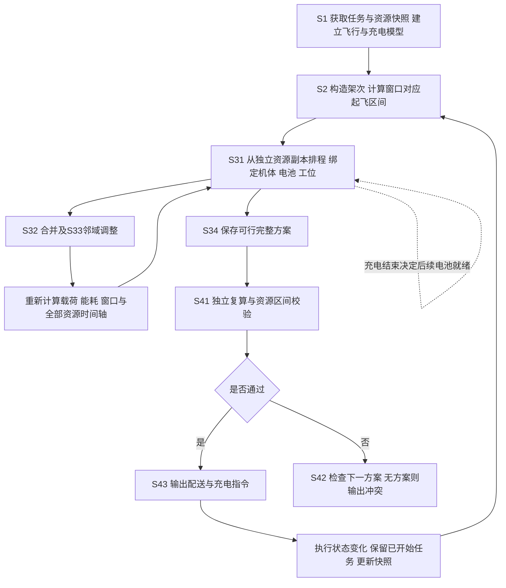
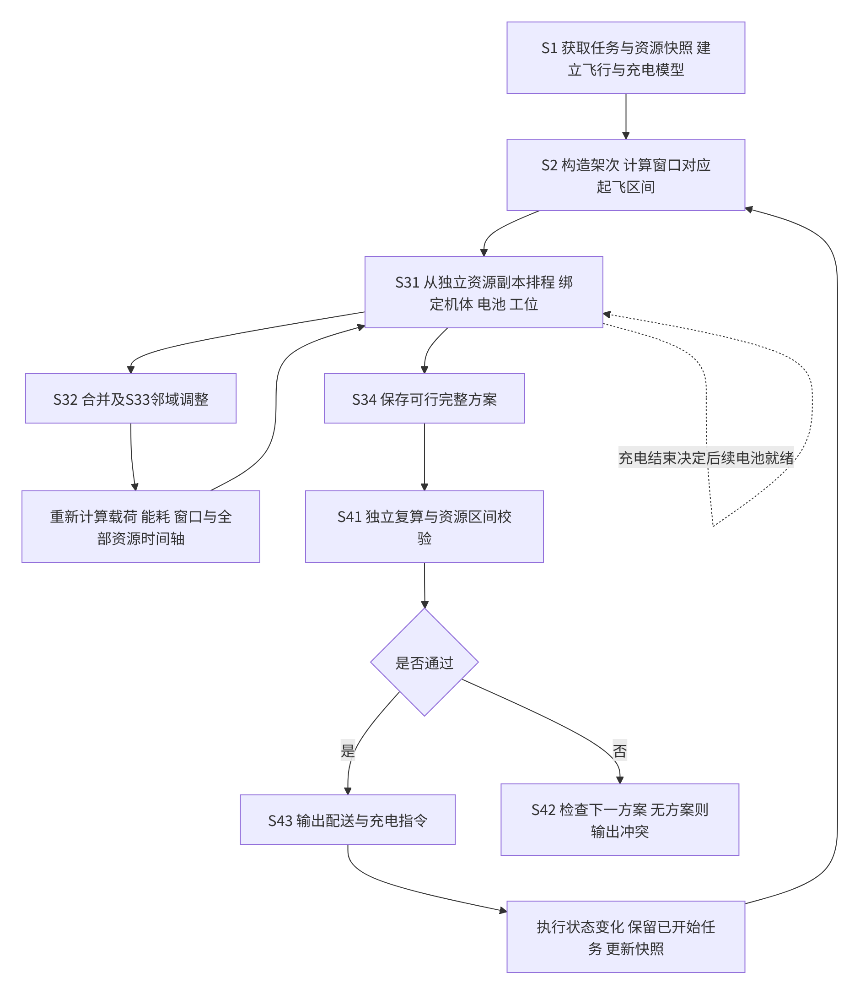
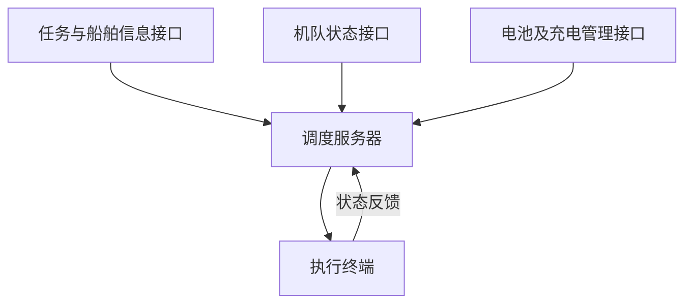
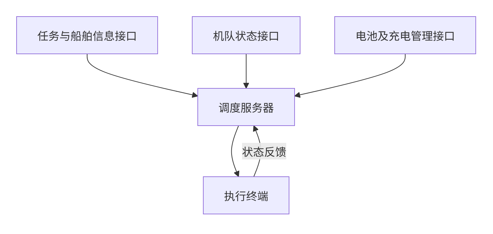
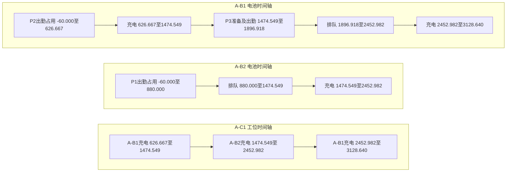
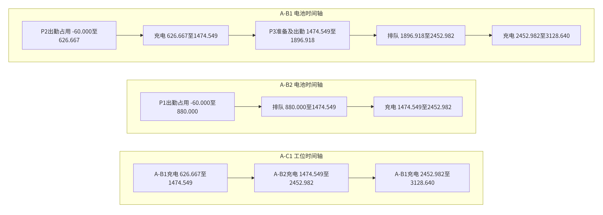

# 说明书摘要

本发明提供一种港口锚地应急物资配送的异构无人机与共享电池协同调度方法及系统，属于无人机配送与能源调度技术领域。所述方法包括：获取物资任务、船舶接收窗口及无人机、电池和充电工位状态；根据架次访问顺序计算逐段剩余载荷、飞行时间、任务能耗和可起飞区间；构造配送架次，通过架次合并与邻域搜索调整货箱组合、访问顺序及机型；每次调整后，重新分配实体无人机、兼容电池和充电工位，将充电排队后的电池可用时刻反馈至后续架次；校验资源占用及交付时限，输出配送与充电指令。本发明将架次调整与设备能源周转联合计算，使配送路线、船舶接收时限和电池再出勤条件保持一致。

# 摘要附图

图1。

# 权利要求书

1、一种港口锚地应急物资配送的异构无人机与共享电池协同调度方法，其特征在于，包括：

获取配送物资的任务信息、船舶接收点及接收窗口信息，以及实体无人机、可更换电池和充电工位的状态信息与兼容关系；

根据配送架次的货箱组合、访问顺序及机型，逐段计算卸载后的剩余载荷、飞行时间和任务能耗，并将船舶接收窗口与物资硬截止时刻转换为该配送架次的可起飞区间；

构造初始配送架次集合，通过架次合并和邻域搜索调整所述货箱组合、访问顺序及机型；每次调整后，从同一初始资源状态重新计算全部配送架次的排程，在所述可起飞区间内联合确定实体无人机、电池、起飞时刻及充电工位；

根据返航后的电池荷电状态、充电工位占用和充电时长，确定充电预约及电池再次可用时刻，并将所述再次可用时刻与实体无人机可用时刻分别作为后续配送架次的准备及起飞约束；

依据最终架次与实体资源绑定记录，独立复算物资交付时刻、返航电量及机体、电池和充电工位的占用区间，输出通过校验的配送架次、设备绑定及充电预约指令。

2、根据权利要求1所述的协同调度方法，其特征在于，所述任务信息包括不可拆货箱的唯一编号、目的船舶、质量、体积、备货完成时刻、期望交付完成时刻、迟到权重和硬截止时刻；所述船舶接收窗口为一个或多个允许进行物资交接的时间区间，交接开始和交接完成位于同一选定窗口内；每个配送架次从岸基配送站起飞，访问至少一个船舶接收点后返回所述岸基配送站。

3、根据权利要求1所述的协同调度方法，其特征在于，所述逐段计算包括：

以配送架次内全部货箱的质量之和确定起飞载荷；每完成一个船舶接收点的交付，扣除该接收点对应货箱的质量，以更新下一航段的剩余载荷；

根据所述剩余载荷确定对应机型的等效航程，根据航段距离、爬升高度及所述等效航程计算航段能耗，将各航段能耗与船舶交接能耗相加，得到任务能耗；

筛除起飞质量或体积超过机型能力，以及任务能耗超过电池可用能量与返航储备之差的配送架次。

4、根据权利要求1所述的协同调度方法，其特征在于，所述可起飞区间通过以下方式确定：

根据访问顺序计算自起飞时刻至各船舶交接开始与交接完成的时间偏移；将各接收窗口的起点减去对应交接开始偏移，将各接收窗口的终点及物资硬截止时刻分别减去对应交接完成偏移；

以得到的各起飞下界的最大值为区间下界，以得到的各起飞上界的最小值为区间上界；下界大于上界时筛除该访问顺序与接收窗口组合；区间非空时还需结合物资与资源就绪条件判断是否可执行；通过岸基延迟起飞使交接过程处于所选择的接收窗口内。

5、根据权利要求1所述的协同调度方法，其特征在于，所述联合确定实体无人机、电池、起飞时刻及充电工位包括：

枚举与机型兼容的实体无人机、电池及充电工位，根据实体无人机可用时刻、满足起飞电量条件的电池可用时刻、备货完成时刻和起飞前准备时长，计算满足可起飞区间且允许完成起飞前准备的起飞时刻；

根据任务能耗计算返航荷电状态，以返航并完成电池拆卸冷却的时刻与充电工位可用时刻中的较晚者确定充电开始时刻；根据返航荷电状态计算充电时长，以充电结束时刻更新电池和充电工位的可用时刻；

分别记录机体从准备开始至返航周转完成的占用区间、电池从准备开始至充电完成的占用区间和工位的实际充电区间，同一实体资源的占用区间互不重叠。

6、根据权利要求5所述的协同调度方法，其特征在于，分别采用期望交付时间优先、硬截止时间优先和配送距离优先的架次顺序进行排程，各顺序均从同一初始资源状态开始计算；按加权迟到量、最晚返航时刻、总任务能耗和架次数构成的词典序，选取可行排程结果。

7、根据权利要求1所述的协同调度方法，其特征在于，所述架次合并对合并后架次重新枚举访问顺序和机型，并重新计算全部架次的资源排程；所述邻域搜索采用模拟退火方式，通过合并、拆分、移动、交换及改派机型生成候选架次集合；每个候选均重新计算逐段载荷、任务能耗、可起飞区间和全部资源排程，剔除违反交付时限、返航电量或资源占用约束的候选，保存经评价得到的可行方案。

8、根据权利要求1所述的协同调度方法，其特征在于，所述校验从最终架次记录中的货箱分配、访问顺序、机型和资源编号重新计算交付时刻、返航荷电状态、充电完成时刻及资源占用区间；逐项检查货箱唯一交付、载质量与容积、接收窗口、物资硬截止、设备兼容关系及同一实体资源的区间重叠；校验失败时检查下一可行方案，全部方案均失败时输出冲突信息。

9、一种港口锚地应急物资配送的异构无人机与共享电池协同调度系统，其特征在于，包括：

任务与船舶信息接口、机队状态接口、电池及充电管理接口、调度服务器和执行终端；

任务与船舶信息接口向调度服务器提供物资任务、船舶接收点及接收窗口信息；机队状态接口提供实体无人机的能力与可用状态；电池及充电管理接口提供电池荷电状态、兼容关系及充电工位状态；

调度服务器根据权利要求1至8任意一项所述协同调度方法进行架次与能源排程，生成配送架次、设备绑定及充电预约指令；

执行终端接收所述指令，并显示货箱分配、船舶访问顺序、实体无人机与电池编号、起飞返航时刻和充电工位预约。

# 说明书

## 一种港口锚地应急物资配送的异构无人机与共享电池协同调度方法及系统

### 技术领域

本发明涉及无人机配送与能源调度技术领域，特别是涉及一种面向港口锚泊船舶应急物资配送的异构无人机与共享电池协同调度方法及系统。

### 背景技术

港口锚泊船舶存在药品、关键备件和检测器材等小批量应急物资需求。采用无人机从岸基配送站向船舶接收点运输物资，需要同时满足物资交付时限、船上接收作业安排以及无人机的载质量和能源条件。不同机型的载质量、容积、巡航速度和能耗参数存在差异；同型号的多架无人机还可以使用兼容的可更换电池，连续配送时需要安排电池拆卸、充电和再次使用。

在多点配送中，货箱组合与访问顺序会改变各航段的剩余载荷，进而改变任务能耗、返航荷电状态和充电时长。仅根据总飞行距离调整配送路线，不能反映卸载后的载荷变化；仅根据无人机空闲时刻安排下一架次，也不能确定是否存在满足起飞电量条件的兼容电池。充电工位数量有限时，返航电池还可能发生排队，导致后续架次无法按原起飞时刻执行。

此外，船舶接收窗口与物资期望送达时间具有不同作用。即使某一访问顺序的总里程较短，如果交接过程超出接收窗口，仍无法完成对应船舶的交付。因此，需要在每次调整货箱组合、访问顺序或机型后，同步重新计算飞行任务和设备能源周转，形成满足接收窗口、返航储备及有限资源条件的配送安排。

### 发明内容

有鉴于此，本发明提供一种港口锚地应急物资配送的异构无人机与共享电池协同调度方法及系统，用于解决锚泊船舶接收时间受限、无人机承载能力与电池充电资源有限的条件下，配送任务的预计交付时刻与实际设备能源可用条件不一致，导致交付超时或输出不可执行任务的问题。

为此，本发明提供以下技术方案：

一种港口锚地应急物资配送的异构无人机与共享电池协同调度方法，包括：

获取物资任务、船舶接收窗口及实体无人机、电池、充电工位状态，建立逐段载荷、飞行时间和任务能耗的计算关系；

构造初始配送架次，根据访问顺序将船舶接收窗口与物资硬截止转换为可起飞区间；

通过架次合并与邻域搜索调整货箱组合、访问顺序和机型，每次调整后重新计算全部架次的资源排程，联合确定实体无人机、电池、起飞时刻和充电工位；

根据返航荷电状态和工位占用计算电池充电完成时刻，并反馈至后续架次的起飞决策；

校验物资交付、返航储备及资源占用区间，输出配送架次、设备绑定和充电预约指令。

进一步地，所述物资任务以不可拆货箱为配送单元，每个货箱具有唯一编号，且只分配至一个配送架次；所述船舶接收窗口允许包括多个互不相交的时间区间，交接开始和完成均位于同一个选定窗口内。

进一步地，所述逐段载荷根据已完成交付的货箱质量更新，并用于计算下一航段的任务能耗；任务能耗包括水平飞行、爬升及船舶交接能耗，返航剩余电量不低于预设储备。

进一步地，所述可起飞区间通过各船舶接收窗口对应的起飞区间与各货箱硬截止对应的起飞上界求交得到，使用岸基等待调整起飞时刻。

进一步地，所述资源排程分别记录实体无人机、电池及充电工位的可用时刻。返航后机体完成周转即可释放，电池完成所需补电与既定周转后才可再次分配；电池充电开始时刻同时受返航拆卸冷却和工位占用约束。

进一步地，采用期望交付时间优先、硬截止时间优先和配送距离优先三种架次顺序分别计算排程，各顺序使用独立资源状态，按加权迟到量、最晚返航时刻、总任务能耗和架次数构成的词典序进行比较。

进一步地，架次合并和邻域搜索中的每个候选均调用同一资源排程过程，候选的访问顺序和机型保持绑定，避免只改变货箱分组而沿用原任务能耗或原电池占用。

进一步地，在输出指令前，依据最终设备编号和架次记录独立复算约束；校验失败时检查下一方案，未得到可执行方案时输出任务和资源冲突信息。

一种港口锚地应急物资配送的异构无人机与共享电池协同调度系统，包括任务与船舶信息接口、机队状态接口、电池及充电管理接口、调度服务器和执行终端。各接口向调度服务器传输对应任务及设备信息；调度服务器执行上述方法，执行终端接收并显示配送与充电指令。

本发明的优点和积极效果：

本发明根据逐次卸载更新航段载荷，将访问顺序变化对应的任务能耗及返航荷电状态纳入排程计算，能够识别不同货箱组合对电池充电和后续出勤的影响。

本发明将船舶交接窗口转换为起飞区间，在岸基确定可执行起飞时刻，能够筛除总航程相同但交接时刻不符合接收安排的访问顺序。

本发明将实体无人机、电池和充电工位分别建模，把充电排队后的电池再次可用时刻反馈至后续架次，并在每次任务调整后重建资源时间轴，能够识别电池未充满或充电工位重叠等冲突，使输出任务能够关联至具体设备和能源预约。

### 协同机制及可选实现方式

本方案的协同机制由相互依赖的计算步骤组成：先按货箱卸载顺序得到逐航段载荷和任务能耗，再把船舶接收作业与硬截止映射为起飞时间限制，随后分别分配机体、电池和充电工位，并将返航电量与实际充电排队导致的电池再次可用时刻返回后续架次。架次内容或机型改变后重新执行这一过程，最后从绑定记录复算，而不是把路线调整与资源预约分开输出。

上述载荷和能耗复算、接收时刻约束、独立实体资源占用及充电反馈共同服务于任务可执行性。三种排程顺序、模拟退火、多随机种子、每架次最多访问3艘船舶、式（3）至式（4）的具体能耗拟合形式、式（10）的两段充电参数以及合并比例1.02，是本实施方式的选择，具体实现可使用经标定的航时与能耗表、实际充电曲线或其他候选搜索方式。替换这些优选计算方式时仍需保持各次候选调整后完整复算、独立资源绑定、充电可用时刻反馈和输出前校验之间的关联。

### 附图说明

图1为本发明协同调度方法的流程图；

图2为本发明异构无人机与共享电池协同调度系统的框架图；

图3为本发明计算实施例中充电排队与电池再次出勤的时间轴示意图。

### 具体实施方式

下面结合附图对本发明的技术方案进行说明。

本实施方式采用一个岸基配送站，配送架次从该站起飞，访问一个或多个锚泊船舶接收点后返回。一个调度批次内，船舶接收点按经确认的固定坐标计算，航段距离、巡航高度及可飞行状态由输入航段数据给出。船上物资采用悬停交接方式，交接时长和能耗纳入架次计算。飞行器避碰、末端交接控制和可飞航段确认由执行系统完成。本调度方法使用已经确认可飞的航段及有效接收窗口，不替代飞控避碰或末端交接控制。气象、船舶位置或作业条件变化使航段或窗口失效时，应更新相应输入后重新计算未开始任务。

“配送架次”是从岸基配送站起飞、完成所携货箱交付并返回岸基配送站的一次任务；“共享电池”是指兼容电池作为独立实体资源在相容无人机之间周转使用，并非允许同一电池同时分配给多个架次；“接收窗口”约束交接开始与完成，而期望交付时刻只用于评价迟到，硬截止用于筛除不可接受的交付。各时刻使用同一批次时间基准，质量、容积和能量使用统一单位。

结合图1，本发明方法具体包括以下步骤。

S1：获取物资任务和设备状态，建立配送架次的飞行与能源计算关系。

S11、获取不可拆货箱集合。对于货箱k，记录目的船舶i(k)、质量m_k、体积v_k、备货完成时刻r_k、期望交付完成时刻d_k、迟到权重w_k及硬截止D_k。无硬截止的货箱将D_k设置为无穷。获取船舶i经确认的接收点坐标、作业高度z_i、交接时长τ_i及接收窗口[α_ih，β_ih]，其中h为窗口编号。

S12、获取实体无人机、电池及充电工位状态。对于机型g，记录载质量Q_g、容积V_g、含电池空载质量m_g^0、巡航速度v_g^cr、爬升速度v_g^up、下降速度v_g^down、空载等效航程L_g^0和满载等效航程L_g^F。对实体无人机u、电池b和充电工位c，分别记录编号、兼容关系和下一可用时刻A_u、A_b、A_c。电池记录有效能量E_b、荷电状态及返航储备下限ρ_b，充电工位记录兼容电池类型。输入状态保存为本批次初始资源快照，候选方案评估不直接改写该快照。“电池下一可用时刻”指电池在完成已安排的充电及必要周转后达到本实施方式的满电出勤条件的时刻，不是单纯的返航时刻。初始满电电池可直接参与分配；初始未满电电池应根据其荷电状态和已有工位预约确定充满时刻，尚未确定该时刻的电池不作为已就绪电池使用。

设本批次允许开始准备的时刻为t_0，备货完成时刻和资源可用时刻均相对于同一时间基准表示。已有执行任务及充电预约所占资源不能被候选评估释放；本实施方式按已有占用的末端确定资源下一可用时刻，以尾部追加方式安排后续任务，不利用已有预约之间的空隙。必要输入缺失、兼容关系未知或资源状态失效时，输出对应缺失信息，暂不将受影响资源用于排程。

主要符号及参数来源如下：

|符号|含义与单位|来源或限定|
|---|---|---|
|m_k、v_k、r_k、d_k、D_k、w_k|货箱质量kg、体积m³、备货/期望/硬截止时刻s、非负迟到权重|物资任务记录；无硬截止时D_k为无穷|
|Q_g、V_g、m_g^0|机型有效载质量kg、容积m³、含所选类型电池空载质量kg|设备能力及配置记录|
|d_ij、H_ij、z_i|航段水平距离、巡航高度、节点作业高度，m|有效航段与接收点数据；各高度使用同一基准|
|v_g^cr、v_g^up、v_g^down|巡航、爬升、下降速度，m/s|设备数据或实测标定，均为正值|
|L_g^0、L_g^F、E_b|空载/满载等效航程m、有效电池能量kWh|对应机型及兼容电池配置下的标定值|
|P_gi^handover、τ_i|交接功率kW、交接时长s|实际交接方式对应的测量或配置值|
|ρ_b、δ_b、τ_pre、τ_turn|返航储备比例、拆卸冷却/准备/机体周转时长s|设备安全运行及周转配置，时长非负|
|t_0、A_u、A_b、A_c|允许准备的批次基准、机体/满电电池/工位下一可用时刻s|已确认任务与资源状态；同一时间轴|
|T_bc^full|电池b在工位c上的等效完全充电时长s|对应组合的充电曲线或充电测试，取正值|
|L_p、U_p、l_pi、e_pi|可起飞区间上下界、交接开始/完成偏移，s|由访问顺序、有效窗口和硬截止复算|

S13、对任一配送架次p，记所载货箱集合为K_p，访问船舶顺序为i_1至i_n。起飞载荷和交付后的剩余载荷为：

$$
q_{p0}=\sum_{k\in K_p}m_k,\qquad q_{pr}=q_{p,r-1}-\sum_{k\in K_p:i(k)=i_r}m_k \tag{1}
$$

式中，q_p0为起飞载荷，q_pr为完成第r个接收点交付后的剩余载荷。由岸基至第一个接收点的航段使用q_p0，第r个接收点至下一节点的航段使用q_pr；全部交付后的返航段载荷为零。起飞质量与体积分别满足q_p0≤Q_g和Σv_k≤V_g。

S14、根据可飞航段数据计算飞行时间。设节点i至节点j的水平航段距离为d_ij，巡航高度为H_ij，节点作业高度为z_i和z_j，采用垂直段与水平段依次计算的航时关系，其中H_ij不低于该航段起止节点作业高度：

$$
t_{gij}=\frac{\max(0,H_{ij}-z_i)}{v_g^{up}}+\frac{d_{ij}}{v_g^{cr}}+\frac{\max(0,H_{ij}-z_j)}{v_g^{down}} \tag{2}
$$

式中，速度单位为m/s，距离与高度单位为m，所得时间单位为s。对已标定的特定设备和环境，也可采用对应航段的实测航时表。

S15、建立载荷相关能耗关系。本实施方式采用以下等效航程和航段能耗模型：

$$
L_g(q)=L_g^0-(L_g^0-L_g^F)\left(\frac{q}{Q_g}\right)^{3/2} \tag{3}
$$

$$
E_{gij}(q)=\frac{d_{ij}E_b}{L_g(q)}+\frac{(m_g^0+q)g_0\max(0,H_{ij}-z_i)}{3.6\times10^6\eta_g^{up}} \tag{4}
$$

式中，L_g(q)为载荷q对应的等效航程，g_0为重力加速度，η_g^up为爬升效率，E_b与E_gij以kWh计。该基础模型的下降附加项取零。空载及满载等效航程须采用与E_b一致的电池配置、环境条件和能耗口径标定；本实施方式同类型兼容电池采用相同有效能量，不能仅改变E_b而沿用不相容的航程参数。式（3）的指数3/2为该实施方式的载荷拟合参数，L_g^0、L_g^F和爬升效率可由设备技术数据及对应配置的飞行标定得到，取值满足Q_g>0、L_g^0≥L_g^F>0、0<η_g^up≤1。航程项对应水平巡航，爬升项单独计入；若航程数据已包含同一爬升过程，则应改用分航段实测能耗模型，避免重复计算。该模型用于排程估算，所给参数不表示已经完成港口实飞验证。

配送架次总任务能耗及返航荷电状态为：

$$
E_p=\sum_{\ell\in\Gamma_p}E_{g\ell}(q_{p\ell})+\sum_{i\in I_p}\frac{P_{gi}^{handover}\tau_i}{3600} \tag{5}
$$

$$
\sigma_{pb}=1-\frac{E_p}{E_b},\qquad \sigma_{pb}\ge\rho_b \tag{6}
$$

式中，Γ_p为架次航段集合，I_p为访问船舶集合，P_gi^handover为交接功率，单位为kW。各架次在起飞前使用充满的兼容电池；不足以满足返航储备的架次被筛除。

S2：构造初始配送架次，将接收窗口转换为可起飞区间。

S21、按照目的船舶、物资硬截止和兼容机型能力构造初始货箱组合。紧急货箱优先形成直接往返或小规模多点架次，普通货箱在载质量及容积允许范围内组批。一个货箱只归属于一个架次，超出所有兼容机型承载能力的不可拆货箱输出无法承运信息。

S22、对各货箱组合枚举承载能力允许的机型和船舶访问排列。本实施方式每架次最多访问3艘船舶，最多枚举6种排列；同一架次送往同一船舶的货箱一起交付。每种排列均根据式（1）至式（6）重新计算航时与能耗。

S23、根据访问顺序，计算从起飞时刻到船舶i交接开始的偏移l_pi与交接完成的偏移e_pi。第一个接收点的开始偏移等于首航段航时；其完成偏移为开始偏移加交接时长。后续接收点的开始偏移等于前一接收点完成偏移加下一航段航时。对选定窗口组合h(i)，计算：

$$
L_p=\max_{i\in I_p}\{\alpha_{ih(i)}-l_{pi}\} \tag{7}
$$

$$
U_p=\min\left\{\min_{i\in I_p}(\beta_{ih(i)}-e_{pi}),\min_{k\in K_p}(D_k-e_{p,i(k)})\right\} \tag{8}
$$

式中，[L_p，U_p]为所选访问排列及窗口组合对应的可起飞区间。L_p大于U_p时，该组合不可行。多窗口情况下分别枚举窗口组合，保留非空区间的并集，不将两个相离区间之间的空档视为可起飞时间。非空区间只说明窗口与硬截止之间相容，仍须由S31检查备货、准备和设备能源就绪条件。该方式在岸基延迟起飞，不安排无人机到达船舶后等待窗口开启。

S24、调用步骤S31所述同步资源排程过程，对初始架次集合计算完整排程。若未找到可行排程，在预设构造次数内调整货箱组合或机型后重新计算；次数用尽时输出无法形成初始方案的任务与资源冲突。

S3：对配送架次进行合并与邻域搜索，每次调整后同步重建资源排程。

S31、建立共用的同步资源排程过程。该过程以候选架次集合和S12保存的资源快照为输入，分别按期望交付时间优先、硬截止时间优先和配送距离优先进行排程。期望时间和硬截止取架次内对应货箱时刻的最小值，按升序排列；配送距离取岸基至架次内最远接收点的距离，按降序排列；并列时按架次编号排序。各顺序使用独立复制的资源状态。

对当前架次p，枚举当前候选机型下允许的访问排列、接收窗口组合以及兼容的实体无人机u、电池b和工位c。候选评价以“货箱集合、机型、访问排列、窗口组合、实体资源绑定”为整体；改变其中任一要素时重新计算相关航时、能耗及排程，不使用其他组合的计算结果。设该架次最晚备货时刻为r_p，起飞前准备时长为τ_pre，则候选起飞时刻为：

$$
s_p=\max\{L_p,\max(t_0,A_u,A_b,r_p)+\tau_{pre}\},\qquad s_p\le U_p \tag{9}
$$

式中，准备开始时刻为s_p−τ_pre，该时刻不得早于t_0及机体、电池、物资可用时刻。对多个可起飞区间分别计算式（9），不在窗口间隙中安排起飞。由s_p与各节点交接偏移计算交付时刻a_k=s_p+e_p,i(k)，由全部航时和交接时长计算返航时刻f_p。

依据式（6）计算返航荷电状态σ_pb。本实施方式采用0至90%阶段占等效完全充电时长65%、90%至100%阶段占35%的充电关系：

$$
t_{bc}^{chg}(\sigma)=T_{bc}^{full}\begin{cases}0.65\dfrac{0.90-\sigma}{0.90}+0.35,&0\le\sigma<0.90,\\0.35\dfrac{1-\sigma}{0.10},&0.90\le\sigma\le1.\end{cases} \tag{10}
$$

式中，T_bc^full为电池b在兼容工位c上的等效完全充电时长。本实施方式同型号电池采用一致的容量与充电参数，实际兼容判断以设备接口数据为准。不同工位充电能力不同时，使用各电池—工位组合对应的T_bc^full；等效完全充电时长、阶段比例和转折荷电状态可由充电测试或设备充电曲线获得。0.90、0.65和0.35为本实施方式的示例参数，不表示对所有电池均适用的固定常数。式（10）在σ=0.90时两段连续，在σ=1时充电时长为零；返航电量已满足储备但未达满电条件时，仍按实际差额安排充电。

设电池返航后的拆卸冷却时长为δ_b，充电开始和结束时刻为：

$$
C_{pb}^{start}=\max\{f_p+\delta_b,A_c\} \tag{11}
$$

$$
C_{pb}^{end}=C_{pb}^{start}+t_{bc}^{chg}(\sigma_{pb}) \tag{12}
$$

候选组合通过容量、窗口、硬截止和返航储备检查后，预先计算后续充电预约。先按该组合交付产生的加权迟到量、返航时刻、充电结束时刻及任务能耗依次比较，选取局部较优组合，并按资源编号处理并列。未被选中的组合不写入资源状态。候选计算使用临时资源副本，仅在选定组合后一次性写入其机体占用、电池占用及工位预约，避免被拒绝候选遗留占用影响下一候选。

选定组合后，机体下一可用时刻更新为f_p+τ_turn，电池下一可用时刻更新为C_pb^end，工位下一可用时刻更新为C_pb^end，其中τ_turn为返航后的机体周转时长。机体、电池和工位分别记录占用区间[准备开始，返航周转完成)、[准备开始，充电完成)和[充电开始，充电完成)。半开区间在前一任务结束时允许后一任务开始。

上述工位排程采用尾部追加方式。一个兼容多类电池的工位使用同一个状态记录，不能按机型重复建立。对于返航荷电状态为1且不需要补电的候选，充电时长为零，不新增工位占用，不因等待工位而推迟电池释放。电池仍需完成拆卸冷却等既定周转，其再次可用时刻取f_p+δ_b。

排定全部架次后，检查资源区间是否重叠；若某一架次不存在候选组合，则撤销该顺序的临时状态并尝试下一顺序。

对各顺序得到的可行完整排程，比较：

$$
J(X)=\bigl(W(X),M(X),E(X),N(X)\bigr) \tag{13}
$$

式中，W(X)=Σ_k w_k max(0，a_k−d_k)为加权迟到量，M(X)=max_p f_p为最晚返航时刻，E(X)=Σ_p E_p为总任务能耗，N(X)为架次数。J(X)是方案的评价向量，方案之间按词典序最小化比较，先比较W，再比较M、E和N。w_k为非负迟到权重，时间项以s计，能量项以kWh计；词典序比较逐项进行，不将不同单位的指标直接相加。返回词典序较好的完整排程；三种顺序全部失败时，返回各失败架次及所选顺序下的冲突原因。该过程采用有限顺序和局部择优，不是完备的可行性判定：返回失败仅表示本次搜索未找到可行排程，不能据此断定所有可能排程均不存在。

S32、进行架次合并。逐对选择架次，将两架次的货箱集合并后，检查载质量、体积和访问节点数量；对满足条件的机型和访问顺序调用S31，重新计算所有架次的排程。对于可行候选，若加权迟到量不增加且最晚返航时刻不超过合并前的预设比例，则接纳合并。本实施方式所述比例取1.02，即允许最晚返航相对合并前增加不超过2%；该比例是可调整的合并接纳参数，增大时允许更大返航时长变化，取1时不允许该指标增加。每接纳一次合并后重新遍历架次对，直至无可接纳合并或达到预设合并次数。本实施方式将合并后的架次数作为后续搜索的架次数上限；这一上限是搜索限制，不代表增加架次数一定没有更好的可行方案。机体、电池和工位的占用仍通过S31分别检查。

S33、进行多邻域模拟退火搜索。以合并后的架次集合为起点，通过以下操作生成候选：合并两个架次；拆分一个架次的货箱集合；将货箱从一个架次移动至另一个架次；交换两个架次中的货箱；在货箱集合不变时改派允许的机型。对每个候选重新计算访问排列、逐段载荷、能耗和窗口，并调用S31重建全部资源排程。候选超过架次数上限或违反硬约束时直接剔除。拆分后的架次数也受该上限约束；当当前方案已经达到上限时，单独拆分会被拒绝，只有当前架次数低于上限时才可接纳不超限的拆分候选。货箱移动或交换后删除空架次，并重新检查货箱唯一归属。

本实施方式设置有限搜索次数、初始温度T_0和降温系数γ，按T_(t+1)=γT_t更新温度。搜索中的辅助标量取F(X)=W(X)+λ_M M(X)+λ_E E(X)，其中λ_M与λ_E为非负预设权重。将w_k视为无量纲时，W和M以s计，λ_M为无量纲，λ_E以s/kWh计，F及温度T均使用一致的时间量纲，确保ΔF/T无量纲。搜索次数为正整数，T_0>0，0<γ<1，参数可通过历史任务批次试算设定并随所选时间、能量单位换算；各次比较使用同一参数配置。在同一预设权重下，ΔF≤0时接纳候选，ΔF>0时以exp(−ΔF/T)的概率接纳候选。每次尝试均计入次数，包括不可行候选。可采用多个固定随机种子重复搜索。

S34、维护可行方案档案。每个通过S31的完整候选均可进入档案，并按式（13）排序，包括通过硬约束检查但未被模拟退火状态转移接纳的完整候选。档案保存方案的货箱组合、访问顺序、机型、实体无人机、电池、充电工位和全部时刻；档案优劣按词典序确定，模拟退火的辅助标量仅用于搜索状态转移。搜索次数用尽后，将档案交步骤S4校验。

S4：复算最终方案并输出任务及充电指令。

S41、根据档案方案的最终货箱分配、访问顺序、机型和设备编号，从输入数据重新计算载荷、航时、任务能耗、交接时刻、返航荷电状态和充电结束时刻，检查每个货箱唯一交付、容量、窗口、硬截止、兼容性以及机体、电池、工位的占用区间。复算使用原始任务、模型参数和最终绑定记录，不直接采用候选缓存的能耗、交付时刻或充电完成时刻；除检查同一资源区间无重叠外，还检查准备不早于资源和物资可用、充电不早于返航拆卸冷却完成，以及再次用电不早于上一占用结束。

S42、按式（13）的顺序校验档案方案，第一份通过校验的方案作为输出结果；校验失败时检查下一方案，全部失败则输出冲突信息。冲突信息至少指明受影响货箱或架次、资源编号或兼容资源缺口、未满足的时间或电量条件，以及失败所在步骤。无方案输出表示在当前候选与搜索范围内未得到通过校验的结果。内部计算采用未舍入值，输出小数仅用于显示。空任务集合不生成飞行或充电指令，直接返回空排程。

S43、生成包括架次编号、货箱编号、访问船舶及顺序、实体无人机编号、电池编号、准备和起飞时刻、交付时刻、返航时刻、返航荷电状态、充电工位编号及充电起止时刻的执行记录。执行终端确认当前设备状态和船舶窗口仍有效后执行。执行前输入发生变化时，先以执行反馈更新资源快照，将已开始任务的货箱、设备绑定及其占用区间保留为不可重新分配部分，再仅对未开始任务调用同一调度及校验过程。候选搜索期间不向执行终端发出正式占用指令；执行终端确认所用任务、船舶窗口和资源状态仍有效后采用对应设备绑定及充电预约，状态不一致时重新计算。已开始飞行任务的应急飞控处置由执行系统完成，不由本排程计算直接替代。

本发明还提供执行上述方法的协同调度系统。结合图2，系统包括任务与船舶信息接口、机队状态接口、电池及充电管理接口、调度服务器和执行终端。

任务与船舶信息接口向调度服务器传输货箱任务、接收位置及窗口；机队状态接口传输实体无人机能力和可用状态；电池及充电管理接口传输电池荷电状态、兼容关系及工位占用状态。调度服务器包括处理器和存储器，存储器保存输入资源快照、飞行与充电模型参数、候选架次、资源时间轴和方案档案，处理器执行S1至S4。执行终端显示配送架次、设备绑定、任务时刻和充电预约，并反馈执行状态。

结合图3，以如下参数设定的计算实施例对同步资源排程进一步说明。岸基配送站O位于局部坐标原点，设置5个船舶接收点，每个接收点对应一个不可拆货箱。时间以本批次调度零点为基准，期望交付时刻与硬截止均取窗口末端，权重均取1。

|船舶及货箱|接收坐标 m|质量 kg|体积 m³|接收窗口 s|
|---|---|---|---|---|
|V1及K1|2000，0|8|0.010|0至400|
|V2及K2|4000，0|6|0.010|0至700|
|V3及K3|0，3000|10|0.010|0至350|
|V4及K4|1000，1000|5|0.010|0至1800|
|V5及K5|负3000，0|12|0.010|0至600|

设置A型实体无人机2架、A型兼容电池2组、A型工位1个；B型实体无人机1架、B型兼容电池1组、B型工位1个。A型的含电池空载质量70 kg、载质量25 kg、容积0.060 m³、巡航速度12 m/s、空载及满载航程25000 m与20000 m、电池有效能量4.5 kWh、等效完全充电时长1800 s。B型对应参数为65 kg、30 kg、0.073 m³、15 m/s、28000 m与16000 m、4.0 kWh及2400 s。

两型的爬升和下降速度均为3 m/s，返航储备为20%，爬升效率0.72，重力加速度9.81 m/s²，交接功率4 kW。巡航高度60 m，岸基作业高度0 m，船舶交接高度20 m，每次交接60 s，准备及机体周转均为60 s。为说明排程，拆卸冷却时长取0，电池初始满电，物资在首批准备开始前备妥，首发架次的准备区间为负60 s至0 s。因此本例取t_0=−60 s、全部初始资源下一可用时刻为−60 s、各货箱备货完成时刻不晚于−60 s；0 s只是首发起飞基准，不是开始准备的时刻。航段按所设坐标间的直线距离输入。

指定P1为A型O至V1至V2至O，P2为A型O至V3至O，P4为B型O至V5至O，P3为A型O至V4至O。以此固定架次集合说明S31和S4的计算，所列数值为该参数设定下的复算结果。

P1起飞载荷14 kg，在V1交付后剩余6 kg，在V2交付后空载返航。三个航段的飞行时间分别为200.000 s、193.333 s和366.667 s；航段能耗分别为0.412008 kWh、0.380175 kWh和0.730597 kWh。两次交接各消耗0.066667 kWh。P1在0 s起飞时，V1与V2交接完成时刻分别为260.000 s与513.333 s，返航时刻880.000 s，总能耗1.656113 kWh，返航荷电状态63.197%，所需充电时长978.433 s。

若交换V1和V2的访问顺序，则总距离及返航时刻相同，但V1交接完成时刻变为680.000 s，超过400 s窗口。该排列的窗口转换区间为[−366.667 s，−280.000 s]，虽然窗口本身给出非空区间，但本例备货与准备条件要求起飞不早于0 s，因此式（9）无法同时满足起飞上界。该排列在S23生成窗口区间后，由S31结合就绪条件拒绝，不能仅凭区间非空认定为可执行。

采用硬截止优先顺序P2、P1、P4、P3，并以固定架次—机型组合进行说明，P1、P2及P3使用A型，P4使用B型。其他机型可行性需通过改变候选机型后另行调用S31检验，不混入本固定组合的数值表。P2先排定，两个A型机体与电池均满足条件且评价相同时，按资源编号选A-U1与A-B1；P1随后选择A-U2与A-B2。P2的充电预约先写入A型工位时间轴，所得任务排程如下。

|架次|实体无人机及电池|起飞 s|交接完成 s|返航 s|能耗 kWh|
|---|---|---|---|---|---|
|P1|A-U2及A-B2|0.000|V1 260.000；V2 513.333|880.000|1.656113|
|P2|A-U1及A-B1|0.000|V3 343.333|626.667|1.204209|
|P3|A-U1及A-B1|1534.549|V4 1745.734|1896.918|0.608049|
|P4|B-U1及B-B1|0.000|V5 293.333|526.667|1.003252|

A-B1在626.667 s返航后开始充电，并在1474.549 s充满；A-B2在880.000 s返航，由于A型工位被占用，需等待至1474.549 s开始充电，并在2452.982 s充满。电池充电排程如下。

|电池及任务|工位|充电开始 s|充电结束 s|排队等待 s|
|---|---|---|---|---|
|A-B1执行P2后|A-C1|626.667|1474.549|0.000|
|A-B2执行P1后|A-C1|1474.549|2452.982|594.549|
|B-B1执行P4后|B-C1|526.667|1628.076|0.000|
|A-B1执行P3后|A-C1|2452.982|3128.640|556.064|

P3所用机体虽已完成周转，但电池需在1474.549 s充满后，再进行60 s准备，所以起飞时刻为1534.549 s；V4交接完成时刻1745.734 s位于1800 s窗口内。若将P3改派B型，则B-B1在1628.076 s才充满，加准备后于1688.076 s起飞，V4交接完成时刻为1875.690 s，超过窗口末端，因此该候选在所述排程顺序下被拒绝。

经S4复算，5个货箱唯一交付，接收窗口及硬截止满足，返航荷电状态均不低于20%。总能耗4.471623 kWh，最晚返航1896.918 s，最后一组电池充满3128.640 s。上述排程说明访问顺序、兼容电池及充电工位如何共同影响配送可执行性。该计算例用于说明资源闭环与约束检查，未给出搜索最优性或与其他调度方法的性能对比，也不等同于实飞试验数据。

上述实施方式用于说明本发明，具体设备及任务参数可按实际配置调整。

# 说明书附图

## 图1 协同调度方法流程图

<!--  -->

## 图2 协同调度系统框架图

<!--  -->

## 图3 充电排队与电池再次出勤示意图

A-C1依次服务P2返航后的A-B1、P1返航后的A-B2及P3返航后的A-B1。A-B1第一次充满后供P3使用；A-B2和A-B1分别产生594.549 s与556.064 s的工位排队等待。各段时间以本批次首发起飞0 s为基准，以下区间单位均为s；“出勤占用”包含起飞前准备及返航后必要周转。图中的数值按三位小数显示，排程使用未舍入值。

<!--  -->
