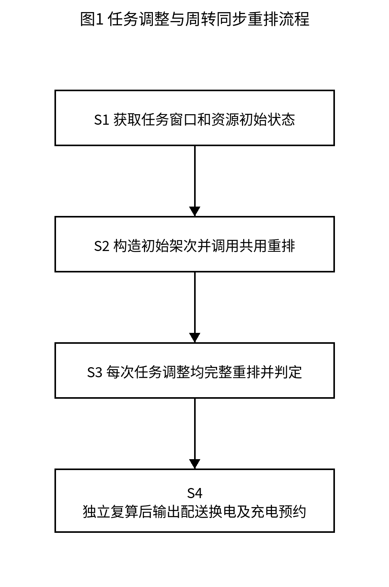
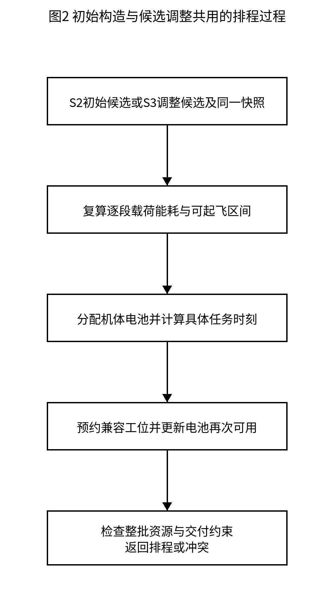
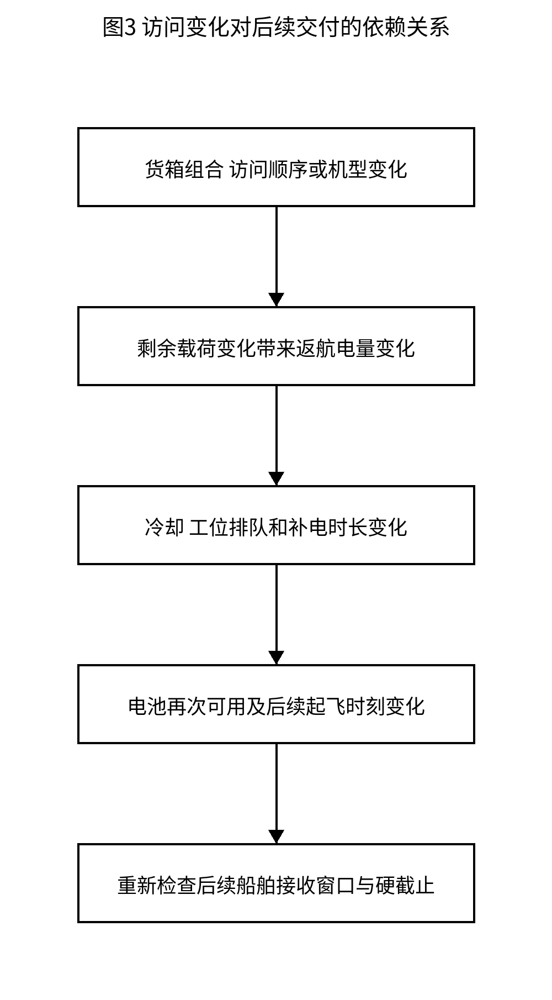

# 一种港口锚地无人机配送任务与电池周转同步重排方法

## 权利要求书

### 权利要求1

一种港口锚地无人机配送任务与电池周转同步重排方法，其特征在于，由调度计算机执行以下步骤：
S1，获取配送货箱、船舶接收点及接收窗口、物资硬截止，以及实体无人机、兼容电池和有限充电工位的状态及兼容关系，保存用于候选比较的资源初始状态；
S2，分配货箱并确定候选机型及船舶访问顺序，构造初始配送架次集合，调用同步资源排程过程形成通过约束检查的初始方案；
S3，对配送架次的货箱组合、船舶访问顺序或机型进行调整，每次调整后均调用所述同步资源排程过程：按照交付后剩余载荷重新计算各航段能耗及预计返航电量，将各船舶接收窗口与物资硬截止转换为可起飞区间，从所述资源初始状态重新分配全部待执行架次的实体无人机、兼容电池、起飞时刻和兼容充电工位；根据预计返航电量、返航后电池周转完成时刻及工位占用确定充电结束时刻，将充电结束时刻作为电池再次可用时刻反馈至后续架次，重建机体、电池和工位的完整占用时间轴，以重建后的交付时刻、电量及资源占用是否满足约束判断该调整能否执行；
S4，依据所选择方案的货箱分配、访问顺序及资源绑定记录独立复算，输出通过复算的配送任务、实体无人机与电池绑定、换电安排及充电工位预约。

### 权利要求2

根据权利要求1所述的方法，其特征在于，所述可起飞区间通过以下方式确定：根据访问顺序计算从起飞至各船舶交接开始和完成的偏移，将选定接收窗口起点减去交接开始偏移作为起飞下界，将窗口终点及对应货箱硬截止分别减去交接完成偏移作为起飞上界，对各船舶和各货箱所得约束求交集；多接收窗口时分别计算窗口组合对应的区间，不将相离区间之间的时间视为可起飞时间；在所选窗口内完成该船舶的整个交接过程。

### 权利要求3

根据权利要求1所述的方法，其特征在于，起飞载荷由架次内全部不可拆货箱质量之和确定，起飞总体积由全部货箱体积之和确定，每完成一个船舶交付后扣除相应货箱质量，以剩余载荷计算下一航段能耗；将包括返航航段的能耗与交接能耗相加确定架次能耗，结合电池可用能量计算预计返航荷电状态并检查返航储备。

### 权利要求4

根据权利要求1所述的方法，其特征在于，针对候选的实体无人机、电池及工位绑定，在所述可起飞区间内确定起飞时刻，使起飞前准备开始时刻不早于机体可用、电池满电可用及物资备妥时刻；机体返航完成自身周转后释放，电池完成必要补电及周转后释放，各候选绑定使用临时状态计算，未选中的候选绑定不写入当前资源时间轴。

### 权利要求5

根据权利要求1所述的方法，其特征在于，电池预计返航后，以电池拆卸冷却完成时刻和所选兼容充电工位可用时刻中的较晚者作为充电开始时刻，根据预计返航荷电状态和对应电池—工位充电参数计算充电时长，得到充电结束时刻并更新该电池及该工位的下一可用时刻；同一实体工位即使兼容多个电池类型也仅使用一份占用时间轴。

### 权利要求6

根据权利要求1所述的方法，其特征在于，分别记录机体从起飞前准备开始至返航周转结束的占用区间、电池从起飞前准备开始至补电周转完成的占用区间以及工位实际充电区间，同一机体、同一电池和同一工位各自的占用区间互不重叠；前一区间结束时允许后一区间开始。

### 权利要求7

根据权利要求1所述的方法，其特征在于，所述调整包括合并配送架次、拆分配送架次、跨架次移动或交换货箱、改变船舶访问顺序以及变更架次机型中的至少一种；每种调整均保持货箱整箱唯一归属，并对调整后的全部待执行架次调用同一个同步资源排程过程，不沿用调整前的起飞时刻、返航电量或充电预约作为调整后的排程。

### 权利要求8

根据权利要求1所述的方法，其特征在于，所述同步资源排程过程对同一候选架次集合采用不同架次排程顺序分别重建时间轴，各排程顺序从相同的资源初始状态独立计算；先筛除违反接收窗口、物资硬截止、承载能力、返航储备及资源占用的完整排程，再对可行排程按加权迟到量、最晚返航时刻、运输能耗和架次数的优先次序比较。

### 权利要求9

根据权利要求1所述的方法，其特征在于，所述独立复算以原始任务属性、航段及设备参数为输入，根据最终货箱、访问顺序和具体机体、电池、工位编号重新计算交接开始及完成时刻、预计返航荷电状态、充电起止时刻和资源区间，检查货箱唯一交付、兼容关系、窗口、硬截止、返航储备和同一实体资源区间不重叠；复算未通过的方案不作为可执行配送与充电预约输出。

## 说明书

### 技术领域

本发明涉及港口锚地无人机物资配送及电池资源调度，具体涉及配送任务调整后的机体、电池和充电工位周转同步重排方法。

### 背景技术

岸基配送站使用不同机型向锚泊船舶配送药品、备件等物资，一个架次可以访问多艘船后返航。有限机体、可更换电池与充电工位需要在后续架次中重复使用。船舶接收作业又受到接收窗口和物资交付时限约束。

仅确定能飞完的路线，不能确定整套作业可以执行。合并或改变访问顺序会改变卸载后的航段载荷和能耗、预计返航电量、补电时间及后续出勤；即使机体空闲，所需兼容电池也可能尚未充满，返航电池还可能等待工位。

因此需要将候选任务变化引起的飞行与能源周转影响传播至全部后续任务，并结合接收窗口及具体设备占用判断候选能否执行。这里描述的不足是本稿拟解决的机制问题，尚未锁定具体最接近对比专利。

### 发明内容

要解决的具体技术问题是，港口多船配送任务的局部调整可能改变后续机体、电池及充电资源可用时刻，使原交接安排超出接收窗口或发生资源冲突，而只检查调整架次本身不能发现这些影响。

采用下述四步骤方法，共用同步资源排程过程贯穿初始构造和每一次候选调整。

S1，获取配送货箱、船舶接收点及接收窗口、物资硬截止，以及实体无人机、兼容电池和有限充电工位的状态及兼容关系，保存用于候选比较的资源初始状态；

S2，分配货箱并确定候选机型及船舶访问顺序，构造初始配送架次集合，调用同步资源排程过程形成通过约束检查的初始方案；

S3，对配送架次的货箱组合、船舶访问顺序或机型进行调整，每次调整后均调用所述同步资源排程过程：按照交付后剩余载荷重新计算各航段能耗及预计返航电量，将各船舶接收窗口与物资硬截止转换为可起飞区间，从所述资源初始状态重新分配全部待执行架次的实体无人机、兼容电池、起飞时刻和兼容充电工位；根据预计返航电量、返航后电池周转完成时刻及工位占用确定充电结束时刻，将充电结束时刻作为电池再次可用时刻反馈至后续架次，重建机体、电池和工位的完整占用时间轴，以重建后的交付时刻、电量及资源占用是否满足约束判断该调整能否执行；

S4，依据所选择方案的货箱分配、访问顺序及资源绑定记录独立复算，输出通过复算的配送任务、实体无人机与电池绑定、换电安排及充电工位预约。

载荷、航时和能耗计算为基础关系；船舶接收窗口转起飞区间和有限工位排队反馈进入同步排程。合并、邻域搜索及模拟退火仅作为候选产生方式，固定算法名称、全部模型参数和试验规模不作为本方法独立项的要求。

### 有益效果

通过调整后逐段复算并完整重建资源时间轴，可以发现访问变化虽不改变总距离却越过船舶接收窗口的情况。

通过把预计SOC及有限工位预约的充电结束反馈至后续起飞，能够区分机体已空闲、电池未就绪以及电池等待工位三类不同资源限制。

通过相同快照下的独立候选副本和输出记录复算，避免被拒绝候选遗留占用或沿用旧时间轴产生看似可行的配送任务。上述作用在本稿人工算例中验证机制关系，不代替完整海事作业效果评估。

### 附图说明

图1为S1至S4的任务调整与周转同步重排流程图，同时作为摘要附图。

图2为初始构造S2及候选调整S3共用的同步资源排程过程。

图3为访问或机型变化通过能耗、排队和补电时刻影响后续交付的依赖关系。

### 计算关系及符号

$$
q_{p0}=\sum_{k\in K_p}m_k,\qquad q_{pr}=q_{p,r-1}-\sum_{k\in K_p:i(k)=i_r}m_k\tag{1}
$$

式（1）：q_p0为架次全部货箱起飞总质量kg；q_pr为第r艘船交付后剩余质量；m_k为不可拆货箱质量，K_p为本架次货箱集合，i(k)为其目的船舶，i_r为第r个访问船舶。后续航段采用交付后的载荷，末次返航为空载。

$$
t_{gij}=\frac{\max(0,H_{ij}-z_i)}{v_g^{up}}+\frac{d_{ij}}{v_g^{cr}}+\frac{\max(0,H_{ij}-z_j)}{v_g^{down}}\tag{2}
$$

式（2）：t_gij为机型g在节点i至j的航时s；H_ij为该航段巡航高度，z_i、z_j为节点作业高度，d_ij为水平距离m；v_g的三个分量为正的爬升、巡航、下降速度m/s。本例高度以同一基准计量。

$$
L_g(q)=L_g^0-(L_g^0-L_g^F)\left(\frac{q}{Q_g}\right)^{3/2}\tag{3}
$$

式（3）：L_g(q)为载荷q下水平等效航程，L_g^0/L_g^F为空载/满载航程m，Q_g为载质量kg。指数3/2为已有设计稿采用的示例拟合，不作为全部设备均应采用的模型。

$$
E_{gij}(q)=\frac{d_{ij}E_b}{L_g(q)}+\frac{(m_g^0+q)g_0\max(0,H_{ij}-z_i)}{3.6\times10^6\eta_g^{up}}\tag{4}
$$

式（4）：E_gij(q)为水平巡航及爬升能耗kWh，E_b为兼容电池有效能量，m_g^0为含该电池配置的空载质量kg，g_0为重力加速度，η_g为爬升效率；3.6×10⁶换算J至kWh。航程输入按水平耗能标定，避免重复计入爬升。

$$
E_p=\sum_{\ell\in\Gamma_p}E_{g\ell}(q_{p\ell})+\sum_{i\in I_p}\frac{P_{gi}^{handover}\tau_i}{3600}\tag{5}
$$

式（5）：E_p为本架次全部航段和各船交接耗能之和；Γ_p为全部航段含返航，I_p为访问船舶集合，P_gi^handover为交接功率kW，τ_i为交接时长s。交接耗能为本海事设计补充，不能归为原论文已验证项。

$$
\sigma_{pb}=1-\frac{E_p}{E_b},\qquad \sigma_{pb}\ge\rho_b\tag{6}
$$

式（6）：σ_pb为电池b执行架次p的预计返航SOC，本实施例起飞SOC=1，ρ_b为返航储备比例。本式为执行前预测，不要求实际返航后才进行候选评价。

$$
L_p=\max_{i\in I_p}\{\alpha_{ih(i)}-l_{pi}\}\tag{7}
$$

式（7）：L_p为所选访问顺序与窗口组合的起飞下界；α_ih为船舶i的第h个窗口开始，l_pi为起飞至该船交接开始的偏移。多艘船的下界取最大值。

$$
U_p=\min\left\{\min_{i\in I_p}(\beta_{ih(i)}-e_{pi}),\min_{k\in K_p}(D_k-e_{p,i(k)})\right\}\tag{8}
$$

式（8）：U_p为起飞上界；β_ih为选定窗口结束，e_pi为交接完成偏移，D_k为货箱硬截止。先对窗口组合求交集；有多个有效组合时保留区间并集，不能填平空隙。窗口区间非空后还须检查式（9）的就绪下界。

$$
s_p=\max\{L_p,\max(t_0,A_u,A_b,r_p)+\tau_{pre}\},\qquad s_p\le U_p\tag{9}
$$

式（9）：s_p为起飞时刻；t_0为允许开始准备的批次基准，A_u为机体可用、A_b为满电电池可用、r_p为本架次最晚备货时刻，τ_pre为准备时长。所有资源与货箱就绪后才能开始准备，不能把机体空闲等同于电池就绪。

$$
t_{bc}^{chg}(\sigma)=T_{bc}^{full}\begin{cases}0.65\dfrac{0.90-\sigma}{0.90}+0.35,&0\le\sigma<0.90,\\0.35\dfrac{1-\sigma}{0.10},&0.90\le\sigma\le1.\end{cases}\tag{10}
$$

式（10）：t_bc^chg为电池b在工位c上充至满电所需时长，T_bc^full为相应完全充电时长s，σ为预计返航SOC。该两阶段曲线是优选示例，可由经校准的对应电池—工位曲线替代；替代后仍须重排。

$$
C_{pb}^{start}=\max\{f_p+\delta_b,A_c\}\tag{11}
$$

式（11）：C_pb^start为充电开始时刻，f_p为返航时刻，δ_b为拆卸冷却时长，A_c为同一实体兼容工位下一可用时刻。该最大值关系引入有限工位排队，不以返航时刻直接认定电池能够开始补电。

$$
C_{pb}^{end}=C_{pb}^{start}+t_{bc}^{chg}(\sigma_{pb})\tag{12}
$$

式（12）：C_pb^end为补电结束时刻；更新A_b和A_c为该时刻，将A_b用于后续式（9）。无需补电时不占用工位，电池仍在完成既定拆卸冷却后释放。

$$
J(X)=\bigl(W(X),M(X),E(X),N(X)\bigr)\tag{13}
$$

式（13）：J(X)为方案评价向量；W为对超过期望交付时刻的加权迟到，M为最晚返航时刻，E为运输总能耗，N为架次数。先用硬约束决定是否可执行，再以该向量比较可行方案。该评价选择是优选实现，未作为独立项固定算法要求。

### 附图

### 实施例一：共用同步资源排程过程与四主步骤

本实施方式以岸基配送站O为起止节点，在一个配送批次内使用经确认的锚泊船舶接收点、可飞航段和接收窗口。货箱整箱承运且唯一交付，同型或经设备配置确认兼容的电池可在相容机体间周转。本文“可执行”指在给定任务、模型与状态快照下通过交付、电量和占用约束检查，不代表已经完成实飞。

S1：获取数据并建立关系。货箱包含编号、目的船舶、质量、体积、备货完成、期望交付、权重和硬截止；船舶包含接收坐标、作业高度、交接时长和一个或多个窗口。机体包含编号、机型、能力及可用时刻；电池包含编号、有效能量、荷电状态及可用时刻；工位包含实体编号、兼容类型、充电参数及可用时刻。所有时刻使用同一基准。初始未满电电池先由已有充电安排确定满电可用时刻，不把返航或入库时刻当作满电时刻。

保存候选比較用的资源快照，每个候选及每种优先顺序使用独立副本。已占用的机体、电池和工位依输入可用时刻继续约束本批次；本例采用资源预约尾部追加，不插入既有预约之间的空隙。快照是当前批次的共同输入，不是允许每次计算把实际已执行占用清零。

S2：构造初始配送架次。根据货箱目的地和时限形成单船或多船组合，枚举相容机型和访问顺序，并调用下述共用过程R。初始方案与调整后候选采用相同物理及资源约束，不另设可以忽略电池或工位的“路线可行”标准。未得到通过检查的完整初始方案时输出冲突信息，不输出局部已排架次作为完整可执行方案。

共用过程R1：对候选全部架次重新计算。访问顺序改变后，按式（1）卸载并更新载荷，按式（2）至（6）复算航时、任务能耗及预计返航SOC。同一机型相容电池使用与能耗模型一致的容量和标定；更改容量或机型后不沿用原航程和能耗。交接开始偏移是此前各航段与交接时长之和，交接完成偏移再加本船交接时长，最后返航也计入任务持续时间。 本例同机型兼容电池采用相同有效能量；若兼容电池配置的容量或标定不同，则分别生成与该配置匹配的物理计算结果，R2只绑定到所匹配配置的实体电池，不用一份能耗/荷电预测覆盖不相容配置。

将所选窗口组合分别代入式（7）（8）。交接开始和结束必须位于同一窗口。多窗口保留每个组合的非空区间，并与硬截止上界求交；不能用最早窗口开始和最晚窗口结束构造覆盖中间空档的大区间。区间非空只表示这些窗口约束相容，仍需在R2检查实际就绪下界。岸基等待在式（9）中体现，不安排到船后等待窗口而遗漏相应悬停耗能。

共用过程R2：按照选定架次排程顺序，在独立状态副本中逐架次枚举访问排列、窗口组合及相容机体、电池、工位。以式（9）确定具体起飞时刻，准备开始不能早于机体、电池和物资就绪。交接完成时刻为起飞加完成偏移，返航时刻为起飞加全部航段与交接时长。起飞超过所选区间上界的组合直接剔除，不通过减小准备或使用未充满电池修补。

共用过程R3：对每个设备绑定预计算返航后预约。由预计SOC和电池—工位曲线计算补电时长，以式（11）的最大值确定充电开始。机体可用更新为返航加机体周转；电池可用与工位可用更新为式（12）的补电结束。工位只有一份物理时间轴，即使兼容A、B两类电池也不能分两份记录而发生重复预约。

电池在飞行、等待工位及补电期间均作为占用资源；机体从准备至返航周转完成占用；工位只在实际补电区间占用。采用半开区间检查同一实体资源无重叠。无需补电的情况不新增工位预约，也不因工位占用无故延迟电池释放，但仍完成必要拆卸冷却。未被选中的机体—电池—工位组合保存在临时计算中，不写入当前时间轴；完整候选失败时丢弃该副本。

共用过程R4：完成全部架次后检查货箱覆盖、整箱唯一交付、载质量及容积、窗口和硬截止、预计返航储备、设备兼容、库存和同一资源区间。通过后可按式（13）比较候选。可以分别采用期望时刻、硬截止和远距优先三种架次排程顺序，或采用其他有明确实现的顺序；三种顺序及词典序评价是优选实现，不替代前述同步重排机制。

S3：调整配送任务并同步重排。合并、拆分、移动、交换、改变访问顺序或改派机型负责生成候选。每次变化都使旧能耗、旧电池释放及旧工位预约失效，故对全部待执行架次调用R；不只复核修改的那一架次，因为其充电变化还可能推迟后续任务。候选通过R的检查才取得可执行性；搜索接纳规则可另行设置，但不能接纳硬约束违约候选。

可使用贪心构造或模拟退火生成和选择候选。若使用辅助标量控制退火状态，其权重与最终优先指标分开；可以保存已评价但未成为当前搜索状态的可行候选。搜索预算、种子、两阶段充电比例、每架次访问上限均为优选参数，不能从固定试验数字推断全局最优或其他任务必然可行。

S4：独立复算并输出。复算程序从最终货箱集合、访问顺序、机型及设备编号恢复载荷、时间偏移、能耗、SOC、充电预约和占用区间，不使用求解器自称“可行”的标签替代检查。输出每架次的准备、起飞、交接和返航时刻、对应机体及电池编号、返航后拆卸及下次换装所用电池、工位及充电起止时刻。这里的指令是提供给执行终端确认的配送、换电及预约记录，不将其表述为已经直接验证飞控自动执行。

批次输入窗口或资源状态失效时，应更新数据后重新评价尚未开始的方案；本稿不提供未披露的应急飞控或船舶动态预测算法。该限制与同步重排的给定输入模型相容。

### 实施例二：人工参数下的基准完整安排

以下采用人工设定的小规模计算例验证所述机制，与原论文山区实例及其结果分开。以开始准备为0 s基准，各货箱初始备妥、机体和电池初始可用且满电；第一批准备0至60 s，起飞60 s。准备及机体周转各60 s，电池拆卸冷却本例取0；改变冷却输入也须重新评价。

船舶V1至V5分别位于(2000,0)、(4000,0)、(0,3000)、(1000,1000)、(−3000,0) m，对应唯一货箱K1至K5的质量分别8、6、10、5、12 kg，体积均0.010 m³。窗口分别为[60,460]、[60,760]、[60,410]、[60,1860]、[60,660] s；各货箱期望和硬截止均取对应窗口末端，权重1。

基准设置A型机体2架、A型电池2组、A型工位1个；B型机体1架、电池1组、工位1个。A型参数为含电池空载70 kg、载质量25 kg、容积0.060 m³、巡航12 m/s、空/满载航程25000/20000 m、电池4.5 kWh、完全充电1800 s；B型对应65 kg、30 kg、0.073 m³、15 m/s、28000/16000 m、4.0 kWh、2400 s。

两型爬升与下降均3 m/s，巡航高度60 m，岸基作业高度0 m，船舶作业高度20 m，交接时长60 s、交接功率4 kW，返航储备20%，爬升效率0.72，重力加速度9.81 m/s²。这些数据用于验证算法关系，尚不能作为某港口设备的实测参数。

固定P1为A型O→V1→V2→O，P2为A型O→V3→O，P4为B型O→V5→O，P3为A型O→V4→O。按P2、P1、P4、P3顺序计算，得到总能耗4.471623 kWh、最晚返航1956.918 s和全部窗口满足的完整安排。本例采用资源编号处理完全并列，不把该并列规则作为保护主线。

P2：A-U1/A-B1；起飞60.000 s，交接完成V3 403.333 s，返航686.667 s；A-C1充电[686.667,1534.549) s，排队0.000 s。

P1：A-U2/A-B2；起飞60.000 s，交接完成V1 320.000；V2 573.333 s，返航940.000 s；A-C1充电[1534.549,2512.982) s，排队594.549 s。

P4：B-U1/B-B1；起飞60.000 s，交接完成V5 353.333 s，返航586.667 s；B-C1充电[586.667,1688.076) s，排队0.000 s。

P3：A-U1/A-B1；起飞1594.549 s，交接完成V4 1805.734 s，返航1956.918 s；A-C1充电[2512.982,3188.640) s，排队556.064 s。

### 实施例三：访问顺序与船舶窗口

机制一：仅将P1顺序改为O→V2→V1→O。总距离仍为8000 m，返航持续时间仍为880 s，但V1交接完成偏移为680 s；最早起飞60 s时，V1交接完成740 s，超过窗口终点460 s。

该排列按窗口转换仍可能产生负时间非空区间，本例为[−306.667,−220.000] s；准备和资源就绪要求起飞不早于60 s，因此二者不相容。拒绝来自窗口与实际就绪的联合检查，而不能仅凭总距离相同或窗口交集非空接纳访问调整。

### 实施例四：机体空闲与电池再次出勤

机制二：P2返航时刻686.667 s，机体周转后在746.667 s可用，A-B1要到1534.549 s才满电。因此P3准备在1534.549 s开始，起飞1594.549 s、V4交接完成1805.734 s，满足1860 s窗口。

如果仅按机体可用安排P3在806.667 s起飞，则电池仍在P2补电区间中。独立检查原型拒绝这份具有过早起飞但仍带“可行”标签的记录。该检查表明输出标签不能代替电池资源就绪检查。

### 实施例五：有限共享工位排队及顺序调整

机制三：使用K3、K4、K5三个货箱，A型仅保留1组电池，机体仍2架；B型仍1机1电池。先分别配置A、B兼容工位，以P4、P2、P3顺序得到可行完整排程，P3交接完成1805.734 s。

随后仅将工位改为同时兼容A、B电池的同一共享工位SHARED-C1，保持候选货箱及顺序不变。P4电池占用工位[586.667,1688.076) s；P2返航686.667 s但要到1688.076 s才能开始充电，排队1001.409 s，充满2535.958 s。

于是P3最早起飞2595.958 s，超过由V4窗口倒推的起飞上界1648.816 s，最早交接完成2807.143 s也超过1860 s。完整重排拒绝该候选，不能沿用独立工位安排下的P3时刻。

使用相同共享工位，改用P2、P4、P3排程顺序可以重新得到可行安排。因此失败只说明该候选和所尝试顺序未通过约束，不能据此断定共享工位条件下所有排程均无解。此结果体现R可作为构造和搜索阶段的共用可执行性判断。

另外检验了两个相离接收窗口，排程不在窗口空隙中起飞；重复计算被拒绝候选后重新评价基准，基准记录完全一致，验证临时状态未污染输入快照。

## 说明书摘要

本发明提供一种港口锚地无人机配送任务与电池周转同步重排方法。获取货箱、船舶接收窗口及机体、电池、有限工位状态，构造初始架次并调用同步资源排程。每次调整货箱组合、访问顺序或机型，重新计算逐段载荷、能耗及可起飞区间，从同一资源初始状态重排全部待执行架次的机体、电池与工位占用；将预计返航电量及工位排队决定的电池充满时刻反馈至后续起飞，用重建后的窗口、硬截止、电量和资源约束判断调整能否执行。经独立复算后输出具体配送、换电与充电预约，保持任务变化与设备能源周转一致。

## 摘要附图

图1。
