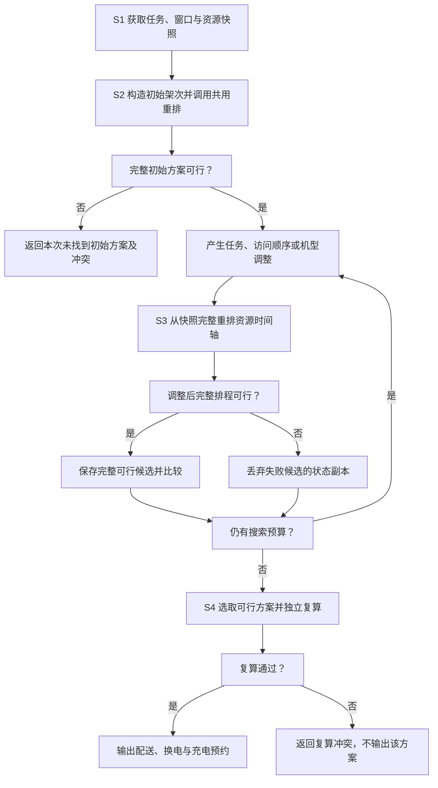
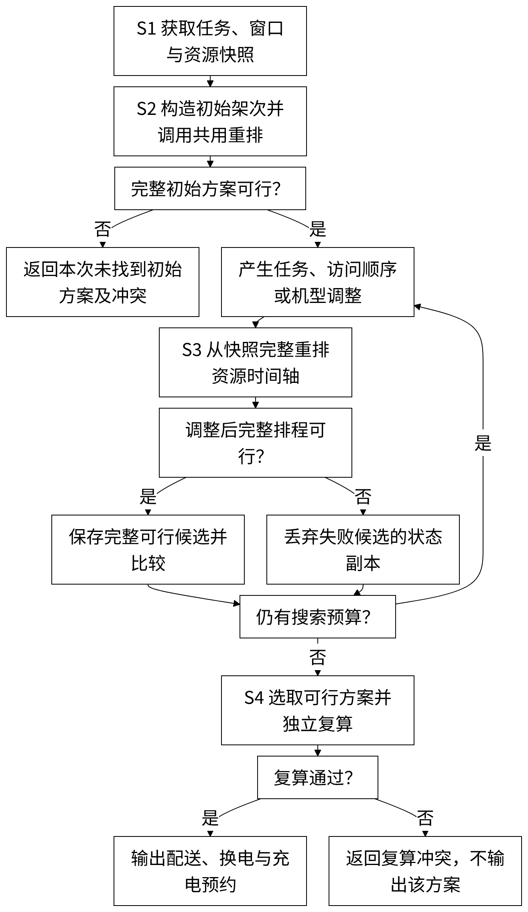
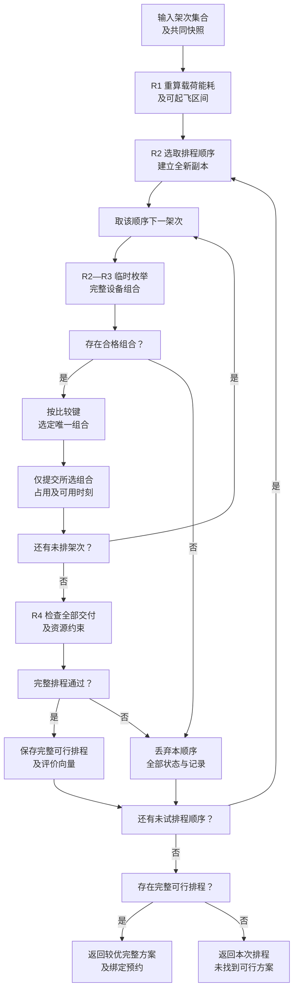
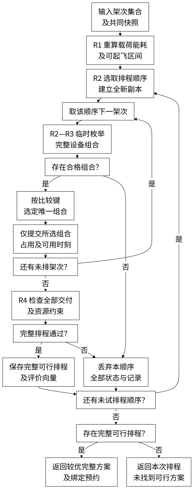
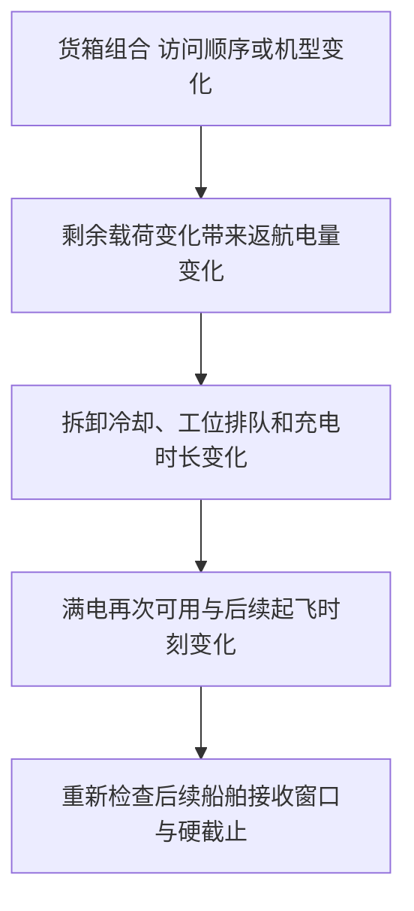
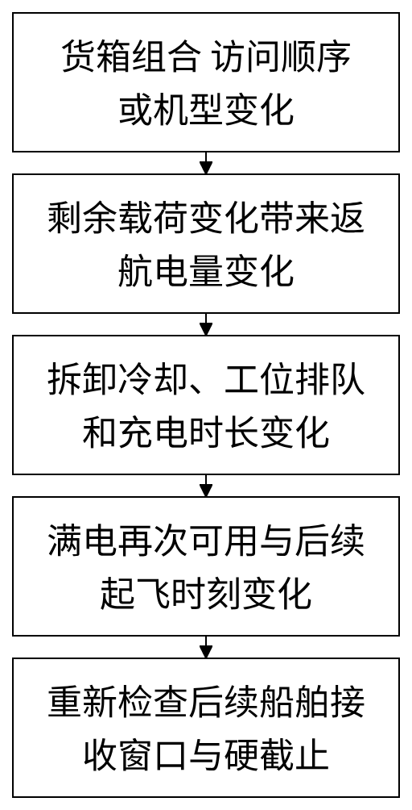

# 一种港口锚地无人机配送任务与电池周转同步重排方法

## 权利要求书

1. 一种港口锚地无人机配送任务与电池周转同步重排方法，其特征在于，由调度计算机执行以下步骤：
S1，获取配送货箱、船舶接收点及接收窗口、物资硬截止，以及实体无人机、兼容电池和有限充电工位的状态及兼容关系，保存用于候选比较的资源初始状态；
S2，分配货箱并确定候选机型及船舶访问顺序，构造初始配送架次集合，调用同步资源排程过程形成通过约束检查的初始方案；
S3，对配送架次的货箱组合、船舶访问顺序或机型进行调整，每次调整后均调用所述同步资源排程过程：按照交付后剩余载荷重新计算各航段能耗及预计返航荷电状态，将各船舶接收窗口与物资硬截止转换为可起飞区间，从所述资源初始状态重新分配全部待执行架次的实体无人机、兼容电池、起飞时刻和兼容充电工位；根据预计返航荷电状态、返航后电池拆卸冷却完成时刻及兼容工位可用时刻，确定充电开始时刻和充电结束时刻，由充电结束时刻及充电后处理时长确定满电再次可用时刻，并将满电再次可用时刻反馈至后续架次，重建机体、电池和工位的完整占用时间轴，以重建后的交付时刻、电量及资源占用是否满足约束判断该调整能否执行；
S4，依据所选择方案的货箱分配、访问顺序及资源绑定记录独立复算，输出通过复算的配送任务、实体无人机与电池绑定、换电安排及充电工位预约。

2. 根据权利要求1所述的方法，其特征在于，所述可起飞区间通过以下方式确定：根据访问顺序计算从起飞至各船舶交接开始和完成的偏移，将选定接收窗口起点减去交接开始偏移作为起飞下界，将窗口终点及对应货箱硬截止分别减去交接完成偏移作为起飞上界，对各船舶和各货箱所得约束求交集；多接收窗口时分别计算窗口组合对应的区间，不将相离区间之间的时间视为可起飞时间；在所选窗口内完成该船舶的整个交接过程。

3. 根据权利要求1所述的方法，其特征在于，起飞载荷由架次内全部不可拆货箱质量之和确定，起飞总体积由全部货箱体积之和确定，每完成一个船舶交付后扣除相应货箱质量，以剩余载荷计算下一航段能耗；将包括返航航段的能耗与交接能耗相加确定架次能耗，结合电池可用能量计算预计返航荷电状态并检查返航储备。

4. 根据权利要求1所述的方法，其特征在于，针对候选的实体无人机、电池及工位绑定，在所述可起飞区间内确定起飞时刻，使起飞前准备开始时刻不早于机体可用、电池满电再次可用及物资备妥时刻；机体返航完成自身周转后释放，电池完成拆卸冷却、必要补电及充电后处理，达到满电再次可用时刻后释放，各候选绑定使用临时状态计算，未选中的候选绑定不写入当前资源时间轴。

5. 根据权利要求1所述的方法，其特征在于，电池预计返航后，以电池拆卸冷却完成时刻和所选兼容充电工位可用时刻中的较晚者作为充电开始时刻，根据预计返航荷电状态和对应电池—工位充电参数计算充电时长，得到充电结束时刻，结合充电后检测或转运时长确定电池满电再次可用时刻，分别更新该电池及该工位的下一可用时刻；充电后处理在工位外完成时，工位在充电结束时释放；同一实体工位即使兼容多个电池类型也仅使用一份占用时间轴。

6. 根据权利要求1所述的方法，其特征在于，分别记录机体从起飞前准备开始至返航周转结束的占用区间、电池从起飞前准备开始至满电再次可用时刻的占用区间以及工位实际充电区间，同一机体、同一电池和同一工位各自的占用区间互不重叠；前一区间结束时允许后一区间开始。

7. 根据权利要求1所述的方法，其特征在于，所述调整包括合并配送架次、拆分配送架次、跨架次移动或交换货箱、改变船舶访问顺序以及变更架次机型中的至少一种；每种调整均保持货箱整箱唯一归属，并对调整后的全部待执行架次调用同一个同步资源排程过程，不沿用调整前的起飞时刻、返航电量或充电预约作为调整后的排程。

8. 根据权利要求1所述的方法，其特征在于，所述同步资源排程过程对同一候选架次集合采用不同架次排程顺序分别重建时间轴，各排程顺序从相同的资源初始状态独立计算；先筛除违反接收窗口、物资硬截止、承载能力、返航储备及资源占用的完整排程，再对可行排程按加权迟到量、最晚返航时刻、运输能耗和架次数的优先次序比较。

9. 根据权利要求1所述的方法，其特征在于，所述独立复算以原始任务属性、航段及设备参数为输入，根据最终货箱、访问顺序和具体机体、电池、工位编号重新计算交接开始及完成时刻、预计返航荷电状态、充电起止时刻和资源区间，检查货箱唯一交付、兼容关系、窗口、硬截止、返航储备和同一实体资源区间不重叠；复算未通过的方案不作为可执行配送与充电预约输出。

## 说明书

### 技术领域

本发明涉及港口锚地无人机物资配送及电池资源调度，具体涉及配送任务调整后的机体、电池和充电工位周转同步重排方法。

### 背景技术

岸基配送站使用不同机型向锚泊船舶配送药品、备件等物资，一个架次可以访问多艘船后返航。有限机体、可更换电池与充电工位需要在后续架次中重复使用。船舶接收作业又受到接收窗口和物资交付时限约束。

仅确定能飞完的路线，不能确定整套作业可以执行。合并或改变访问顺序会改变卸载后的航段载荷和能耗、预计返航荷电状态、补电时间及后续出勤；即使机体空闲，所需兼容电池也可能尚未充满，返航电池还可能等待工位。

因此需要将候选任务变化引起的飞行与能源周转影响传播至全部后续任务，并结合船舶接收窗口及具体设备占用判断候选能否执行。

### 发明内容

要解决的具体技术问题是，港口多船配送任务的局部调整可能改变后续机体、电池及充电资源可用时刻，使原交接安排超出接收窗口或发生资源冲突，而只检查调整架次本身不能发现这些影响。

采用下述四步骤方法，共用同步资源排程过程贯穿初始构造和每一次候选调整。

S1，获取配送货箱、船舶接收点及接收窗口、物资硬截止，以及实体无人机、兼容电池和有限充电工位的状态及兼容关系，保存用于候选比较的资源初始状态；

S2，分配货箱并确定候选机型及船舶访问顺序，构造初始配送架次集合，调用同步资源排程过程形成通过约束检查的初始方案；

S3，对配送架次的货箱组合、船舶访问顺序或机型进行调整，每次调整后均调用所述同步资源排程过程：按照交付后剩余载荷重新计算各航段能耗及预计返航荷电状态，将各船舶接收窗口与物资硬截止转换为可起飞区间，从所述资源初始状态重新分配全部待执行架次的实体无人机、兼容电池、起飞时刻和兼容充电工位；根据预计返航荷电状态、返航后电池拆卸冷却完成时刻及兼容工位可用时刻，确定充电开始时刻和充电结束时刻，由充电结束时刻及充电后处理时长确定满电再次可用时刻，并将满电再次可用时刻反馈至后续架次，重建机体、电池和工位的完整占用时间轴，以重建后的交付时刻、电量及资源占用是否满足约束判断该调整能否执行；

S4，依据所选择方案的货箱分配、访问顺序及资源绑定记录独立复算，输出通过复算的配送任务、实体无人机与电池绑定、换电安排及充电工位预约。

逐段载荷、航时和能耗计算确定预计返航荷电状态；接收窗口确定起飞限制，充电工位预约及电池满电再次可用时刻递推决定后续架次的起飞条件。初始构造和候选调整均采用上述计算关系。

### 有益效果

通过调整后逐段复算并完整重建资源时间轴，可以发现访问变化虽不改变总距离却越过船舶接收窗口的情况。

将预计返航荷电状态、工位排队及充电后处理决定的电池满电再次可用时刻反馈至后续起飞，能够分别识别机体尚未空闲、电池尚未就绪及电池等待工位引起的起飞限制。

候选绑定仅在临时记录中计算，选定后提交；排程失败丢弃该顺序的整个状态副本。结合输出记录复算，可以排除被拒绝候选遗留占用或沿用旧时间轴导致的资源冲突。

### 附图说明

图1为S1至S4流程，示出候选调整循环、失败副本丢弃及独立复算后输出，同时作为摘要附图。

图2为S2和S3共用的排程过程，示出逐架次组合选择、状态提交以及顺序失败回滚与切换。

图3为访问变化经能耗、工位排队及电池满电再次可用时刻反馈至后续交付的依赖关系。

### 具体实施方式

#### 实施例一：共用同步资源排程过程与四主步骤

本实施方式以岸基配送站O为起止节点，在一个配送批次内使用经确认的锚泊船舶接收点、可飞航段和接收窗口。货箱整箱承运且唯一交付，同型或经设备配置确认兼容的电池可在相容机体间周转。本文“可执行”指在给定任务、模型与状态快照下通过交付、电量和占用约束检查，其判定以本批次输入状态为条件。

S1：获取数据并建立关系。货箱包含编号、目的船舶、质量、体积、备货完成、期望交付、权重和硬截止；船舶包含接收坐标、作业高度、交接时长和一个或多个窗口。机体包含编号、机型、能力及可用时刻；电池包含编号、有效能量、荷电状态及可用时刻；工位包含实体编号、兼容类型、充电参数及可用时刻。所有时刻使用同一基准。初始未满电电池先由已有充电安排确定满电再次可用时刻，不把返航或入库时刻当作满电时刻。

保存候选比较用的资源快照，每个候选及每种优先顺序使用独立副本。已占用的机体、电池和工位依输入可用时刻继续约束本批次；本例采用资源预约尾部追加，不插入既有预约之间的空隙。快照是当前批次的共同输入，不是允许每次计算把实际已执行占用清零。

S2：构造初始配送架次。根据货箱目的地和时限形成单船或多船组合，枚举相容机型和访问顺序，并调用下述共用过程R。初始方案与调整后候选采用相同物理及资源约束，不另设可以忽略电池或工位的“路线可行”标准。未得到通过检查的完整初始方案时输出冲突信息，不输出局部已排架次作为完整可执行方案。

共用过程R1：对全部候选架次重新计算逐段载荷、航时、能耗及预计返航荷电状态。起飞载荷及卸载更新采用式（1），飞行关系采用式（2）至（6）。同机型相容电池配置采用一致容量与标定；容量或标定不同的配置分别计算物理结果，后续仅绑定与该结果相匹配的实体电池。

$$
q_{p0}=\sum_{k\in K_p}m_k,\qquad q_{pr}=q_{p,r-1}-\sum_{k\in K_p:i(k)=i_r}m_k
$$

式（1）：起飞质量为$q_{p0}$，第$r$艘船交付后的剩余质量为$q_{pr}$，单位kg。$m_k$为货箱质量，$K_p$为架次货箱集合，$i(k)$为货箱目的船舶，$i_r$为第$r$个访问点；后续航段采用卸载后的质量，末次返航为空载。

$$
t_{gij}=\frac{\max(0,H_{ij}-z_i)}{v_g^{up}}+\frac{d_{ij}}{v_g^{cr}}+\frac{\max(0,H_{ij}-z_j)}{v_g^{down}}
$$

式（2）：$t_{gij}$为机型$g$在节点$i$至$j$的航时s；$H_{ij}$为航段巡航高度，$z_i$、$z_j$为同一基准下的节点作业高度，$d_{ij}$为水平距离m；$v_g^{up}$、$v_g^{cr}$、$v_g^{down}$分别为正的爬升、巡航和下降速度m/s。

$$
L_g(q)=L_g^0-(L_g^0-L_g^F)\left(\frac{q}{Q_g}\right)^{3/2}
$$

式（3）：$L_g(q)$为载荷$q$下的水平等效航程m；$L_g^0$、$L_g^F$为空载及满载航程，$Q_g$为载质量上限kg。指数3/2用于本实施例的拟合关系，设备配置变化时采用对应标定。

$$
E_{gij}(q)=\frac{d_{ij}E_b}{L_g(q)}+\frac{(m_g^0+q)g_0\max(0,H_{ij}-z_i)}{3.6\times10^6\eta_g^{up}}
$$

式（4）：$E_{gij}(q)$为航段能耗kWh；$E_b$为相容电池有效能量kWh，$m_g^0$为含电池配置的空载质量kg，$g_0$为重力加速度，$\eta_g^{up}$为爬升效率。系数$3.6\times10^6$用于J至kWh的换算；水平航程按水平耗能标定，以避免重复计入爬升。

$$
E_p=\sum_{\ell\in\Gamma_p}E_{g\ell}(q_{p\ell})+\sum_{i\in I_p}\frac{P_{gi}^{handover}\tau_i}{3600}
$$

式（5）：$E_p$为全部航段与交接能耗之和；$\Gamma_p$含返航航段，$q_{p\ell}$为航段$\ell$的实际载荷，$I_p$为访问船舶集合，$P_{gi}^{handover}$为交接功率kW，$\tau_i$为交接时长s。

$$
\sigma_{pb}=1-\frac{E_p}{E_b},\qquad \sigma_{pb}\ge\rho_b
$$

式（6）：$\sigma_{pb}$为预计返航荷电状态，$\rho_b$为储备比例。本实施例起飞时满电，故起飞荷电状态为1；该值在候选评价时预测。

按访问顺序递推交接开始和完成偏移，并计入最后返航航段；式（7）给出递推关系。

$$
\begin{matrix}l_{p,i_1}=t_{g_p,O i_1},\\e_{p,i_r}=l_{p,i_r}+\tau_{i_r},\\l_{p,i_{r+1}}=e_{p,i_r}+t_{g_p,i_r i_{r+1}}.\end{matrix}
$$

式（7）：$l_{pi}$和$e_{pi}$分别为从起飞至船舶$i$交接开始及完成的偏移，$g_p$为本架次机型；逐船累计航时和交接时长，最后加返航航时得到任务持续时间。

分别枚举各船舶接收窗口组合，依式（8）、式（9）求可起飞区间。交接开始和完成须落在该船舶同一个窗口内；保留各组合的非空区间并集，不填平空隙。岸基等待通过起飞时刻体现，本实施方式不在抵船后等待窗口。

$$
L_p=\max_{i\in I_p}\{\alpha_{ih(i)}-l_{pi}\}
$$

式（8）：所选访问顺序及窗口组合的起飞下界为$L_p$；$\alpha_{ih(i)}$为船舶$i$选定第$h(i)$个窗口的开始时刻。各船舶下界取最大值。

$$
U_p=\min\left\{\min_{i\in I_p}(\beta_{ih(i)}-e_{pi}),\min_{k\in K_p}(D_k-e_{p,i(k)})\right\}
$$

式（9）：起飞上界为$U_p$；$\beta_{ih(i)}$为选定窗口结束，$D_k$为货箱硬截止。逐窗口组合保留非空区间，不填平相离区间空隙；还须检查式（10）的就绪下界。

共用过程R2：为同一架次集合产生三种排程顺序。第一种按架次内货箱最早期望交付时刻升序；第二种按架次内货箱最早硬截止升序；第三种按架次内逐箱目的船舶至岸基水平距离之和降序。第三种计算每个货箱对应距离，同船多个货箱逐箱计入，不将该值解释为多点路线长度。三种排序均用架次编号字符串升序处理并列；相同的排序结果可以重复尝试。各顺序从同一资源初始状态建立全新副本。

在当前顺序内依次处理架次，枚举其允许访问排列、有效窗口组合、相容机体、相容电池及兼容工位。固定访问顺序的候选只枚举该顺序，允许调整顺序的候选枚举目的船舶的不同排列。按式（10）确定各组合的最早起飞时刻，超出上界的组合剔除；以起飞加交接完成偏移得到各船舶交付时刻，起飞加任务持续时间得到返航时刻。

$$
s_p=\max\{L_p,\max(t_0,A_u,A_b,r_p)+\tau_{pre}\},\qquad s_p\le U_p
$$

式（10）：起飞时刻为$s_p$；$t_0$为允许开始准备的批次基准，$A_u$为机体可用时刻，$A_b$为电池满电再次可用时刻，$r_p$为本架次最晚备货完成时刻，$\tau_{pre}$为准备时长。准备开始为$s_p-\tau_{pre}$。机体、电池和货箱均就绪后才可准备。

共用过程R3：在不改写当前状态的临时记录中，为每个合格设备组合计算返航后拆卸冷却、充电及满电再次可用。先由式（11）计算充电时长，再由式（12）、式（13）确定充电开始和结束，最后由式（14）计算电池满电再次可用时刻。工位预约在已有预约尾部追加。

$$
t_{bc}^{chg}(\sigma)=T_{bc}^{full}\begin{cases}0.65\dfrac{0.90-\sigma}{0.90}+0.35,&0\le\sigma<0.90,\\0.35\dfrac{1-\sigma}{0.10},&0.90\le\sigma\le1.\end{cases}
$$

式（11）：$t_{bc}^{chg}(\sigma)$为电池$b$在工位$c$上充至满电的时长s，$T_{bc}^{full}$为相应完全充电时长s，$\sigma$为返航荷电状态。该两段关系用于本实施例；可输入经校准的电池—工位曲线，替换后重新排程。

$$
C_{pb}^{start}=\max\{f_p+\delta_b,A_c\}
$$

式（12）：$C_{pb}^{start}$为充电开始时刻，$f_p$为返航时刻，$\delta_b$为拆卸冷却时长，$A_c$为实体兼容工位下一可用时刻。$f_p+\delta_b$仅表示拆卸冷却完成，与充电结束及满电再次可用分开。

$$
C_{pb}^{end}=C_{pb}^{start}+t_{bc}^{chg}(\sigma_{pb})
$$

式（13）：$C_{pb}^{end}$为充电结束时刻。在充电后处理于工位外完成的配置下，更新工位下一可用时刻为$C_{pb}^{end}$；电池下一可用时刻另按式（14）计算。

$$
A_b^{full}=C_{pb}^{end}+\delta_b^{post}
$$

式（14）：$A_b^{full}$为电池满电再次可用时刻，$\delta_b^{post}$为工位外充电后检测及转运时长，且不小于0。更新后续式（10）所用的$A_b$为$A_b^{full}$。无需该处理时令时长为0；若处理继续占用充电工位，则工位占用终点也应包含该时长。

对每个合格组合记录交付时刻、返航时刻、预计返航荷电状态、充电起止时刻、满电再次可用时刻、任务能耗和三类资源占用区间。局部比较依次取较小的架次加权迟到量、返航时刻、电池满电再次可用时刻、任务能耗、充电结束时刻；若仍并列，依次按机体编号、电池编号、工位编号、访问排列和窗口组合序号升序选取。编号按字符串顺序，访问排列按船舶编号逐项比较，窗口组合序号按输入窗口枚举顺序确定；无需充电时工位编号按空字符串比较。该规则仅选择当前架次的组合，不表示其为整批最优绑定。

只提交选中组合：更新机体下一可用时刻为返航加机体周转时长，更新电池下一可用时刻为满电再次可用时刻，并更新所选工位的占用终点。未选中组合全部丢弃，不改写副本。随后处理下一架次。本实施方式对已选组合不在同一顺序中回溯；若任一后续架次没有合格组合，丢弃该顺序已经产生的全部记录和资源状态，从初始快照切换到下一排程顺序。

机体从准备开始至返航机体周转结束占用；电池从准备开始至满电再次可用占用，涵盖飞行、拆卸冷却、等待、补电及工位外处理；工位仅在实际充电区间占用。采用半开区间，前一区间结束时可开始后一区间。无需补电时不预约工位，将充电起止记为拆卸冷却完成时刻，再加必要的后处理得到电池满电再次可用。

共用过程R4：全部架次完成后，检查货箱覆盖、整箱唯一交付、载质量和容积、窗口和硬截止、返航储备、设备兼容、库存及同一实体资源区间无重叠。各完整可行排程按式（15）由左至右取较小者；评价向量完全相同时，保留三种排程顺序中先生成的结果。所有尝试均失败时，返回“本次排程未找到可行方案”，并返回失败架次及原因；不将该返回值解释为所有排序或绑定均不存在可行解。

$$
J(X)=\bigl(W(X),M(X),E(X),N(X)\bigr)
$$

式（15）：$J(X)$为完整可行方案评价向量；$W(X)$为逐箱加权迟到量，$M(X)$为最晚返航时刻，$E(X)$为运输总能耗，$N(X)$为架次数。$W(X)=\sum_k w_k\max(0,d_k^{deliver}-d_k^{due})$，其中$w_k$为权重，$d_k^{deliver}$为交接完成时刻，$d_k^{due}$为期望交付时刻。仅比较通过硬约束的完整排程。

S3：合并、拆分、移动、交换货箱、改变访问顺序或机型生成候选，每次变化后对全部待执行架次调用上述R1至R4。候选失败即丢弃其计算状态；通过后可保存可行候选并按评价向量选择较优者。候选生成可使用贪心或模拟退火等搜索，每次评价均重建全部时间轴；达到预设迭代次数或时间预算后，选择已保存的完整可行方案进入S4。

S4：从所选方案的货箱集合、访问顺序、机型及实体设备编号独立恢复载荷、时间偏移、能耗、预计返航荷电状态、充电预约和三类占用区间，检查原始任务与资源约束。复算失败时不输出该方案；成功时输出逐架次准备、起飞、交接和返航时刻、机体及电池编号、拆卸冷却及换电安排、工位充电起止和电池满电再次可用时刻，形成配送、换电和充电预约记录。

当批次输入窗口或资源状态失效时，更新任务和资源状态，重新评价尚未开始的配送任务。

#### 实施例二：给定参数下的基准完整安排

以下为人工设定的五船计算示例，用于说明各项约束及反馈关系。以开始准备为0 s基准，各货箱初始备妥，机体和电池初始可用且电池满电；第一批准备0至60 s，起飞60 s。准备及机体周转各60 s，拆卸冷却时长和充电后处理时长均取0；改变上述输入后重新评价。

船舶V1至V5分别位于(2000,0)、(4000,0)、(0,3000)、(1000,1000)、(−3000,0) m，对应唯一货箱K1至K5的质量分别8、6、10、5、12 kg，体积均0.010 m³。窗口分别为[60,460]、[60,760]、[60,410]、[60,1860]、[60,660] s；各货箱期望和硬截止均取对应窗口末端，权重1。

基准设置A型机体2架、A型电池2组、A型工位1个；B型机体1架、电池1组、工位1个。A型参数为含电池空载70 kg、载质量25 kg、容积0.060 m³、巡航12 m/s、空/满载航程25000/20000 m、电池4.5 kWh、完全充电1800 s；B型对应65 kg、30 kg、0.073 m³、15 m/s、28000/16000 m、4.0 kWh、2400 s。

两型爬升与下降均3 m/s，巡航高度60 m，岸基作业高度0 m，船舶作业高度20 m，交接时长60 s、交接功率4 kW，返航储备20%，爬升效率0.72，重力加速度9.81 m/s²。这些数据为本计算示例的输入参数。

固定P1为A型O→V1→V2→O，P2为A型O→V3→O，P4为B型O→V5→O，P3为A型O→V4→O。按P2、P1、P4、P3顺序计算，得到总能耗4.471623 kWh、最晚返航1956.918 s和全部窗口满足的完整安排。本例按R3的局部比较及并列处理规则选定资源绑定。

P2：A-U1/A-B1；起飞60.000 s，交接完成V3 403.333 s，返航686.667 s；A-C1充电[686.667,1534.549) s，排队0.000 s。

P1：A-U2/A-B2；起飞60.000 s，交接完成V1 320.000；V2 573.333 s，返航940.000 s；A-C1充电[1534.549,2512.982) s，排队594.549 s。

P4：B-U1/B-B1；起飞60.000 s，交接完成V5 353.333 s，返航586.667 s；B-C1充电[586.667,1688.076) s，排队0.000 s。

P3：A-U1/A-B1；起飞1594.549 s，交接完成V4 1805.734 s，返航1956.918 s；A-C1充电[2512.982,3188.640) s，排队556.064 s。

#### 实施例三：访问顺序与船舶窗口

机制一：仅将P1顺序改为O→V2→V1→O。总距离仍为8000 m，返航持续时间仍为880 s，但V1交接完成偏移为680 s；最早起飞60 s时，V1交接完成740 s，超过窗口终点460 s。

该排列按窗口转换仍可能产生负时间非空区间，本例为[−306.667,−220.000] s；准备和资源就绪要求起飞不早于60 s，因此二者不相容。拒绝来自窗口与实际就绪的联合检查，而不能仅凭总距离相同或窗口交集非空接纳访问调整。

#### 实施例四：机体空闲与电池再次出勤

机制二：P2返航时刻686.667 s，机体周转后在746.667 s可用，A-B1要到1534.549 s才达到满电再次可用时刻。因此P3准备在1534.549 s开始，起飞1594.549 s、V4交接完成1805.734 s，满足1860 s窗口。

如果仅按机体可用安排P3在806.667 s起飞，则准备开始746.667 s时电池仍在P2补电区间中。按电池满电再次可用时刻检查，可判定该记录违反电池就绪约束；即使记录带有可行标签，也不得输出为可执行任务。

#### 实施例五：有限共享工位排队及顺序调整

机制三：使用K3、K4、K5三个货箱，A型仅保留1组电池，机体仍2架；B型仍1机1电池。先分别配置A、B兼容工位，以P4、P2、P3顺序得到可行完整排程，P3交接完成1805.734 s。

随后仅将工位改为同时兼容A、B电池的同一共享工位SHARED-C1，保持候选货箱及顺序不变。P4电池占用工位[586.667,1688.076) s；P2返航686.667 s但要到1688.076 s才能开始充电，排队1001.409 s，充满2535.958 s。

于是P3最早起飞2595.958 s，超过由V4窗口倒推的起飞上界1648.816 s，最早交接完成2807.143 s也超过1860 s。完整重排拒绝该候选，不能沿用独立工位安排下的P3时刻。

使用相同共享工位，改用P2、P4、P3排程顺序可以重新得到可行安排。因此失败只说明该候选和所尝试顺序未通过约束，不能据此断定共享工位条件下所有排程均无解。此结果体现R可作为构造和搜索阶段的共用可执行性判断。

多接收窗口情况下，按窗口组合分别形成区间；相离窗口之间的时间不属于可起飞区间。被拒绝候选的状态副本整体丢弃，后续候选仍从共同输入快照计算。

#### 实施例六：充电结束与满电再次可用分离

采用P2和P3两个架次，仅保留货箱K3及K4、两架A型机体、一组A型电池和A-C1工位，将V4窗口、K4期望及硬截止均放宽至2600 s。工位外充电后检测及转运时长设为120 s，其他参数保持实施例二设置。

P2充电仍在1534.549 s结束，工位此时释放；A-B1满电再次可用时刻为1654.549 s。因此P3准备在1654.549 s开始，起飞1714.549 s、交接完成1925.734 s，满足放宽后的窗口。该电池在充电结束至满电再次可用的120 s内仍不能用于下一架次。

### 说明书附图

#### 图1 任务调整与周转同步重排流程

<!--  -->

#### 图2 逐架次选择与失败回滚的共用排程

<!--  -->

#### 图3 访问变化对后续交付的依赖关系

<!--  -->

## 说明书摘要

本发明提供一种港口锚地无人机配送任务与电池周转同步重排方法。获取货箱、船舶接收窗口及机体、电池、有限工位状态，构造初始架次并调用同步资源排程。每次调整货箱组合、访问顺序或机型，重新计算逐段载荷、能耗及可起飞区间，从同一资源初始状态重排全部待执行架次的机体、电池与工位占用；将预计返航荷电状态及工位排队决定的电池满电再次可用时刻反馈至后续起飞，用重建后的窗口、硬截止、电量和资源约束判断调整能否执行。经独立复算后输出具体配送、换电与充电预约，保持任务变化与设备能源周转一致。

## 摘要附图

图1。

---

## 审阅资料（独立附件）

[审核材料Word](port-dispatch_20261012113350-review.docx)；[来源、代码和运行证据索引](port-dispatch_20261012113350-source-index.md)。
