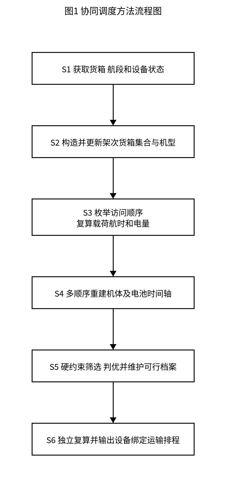
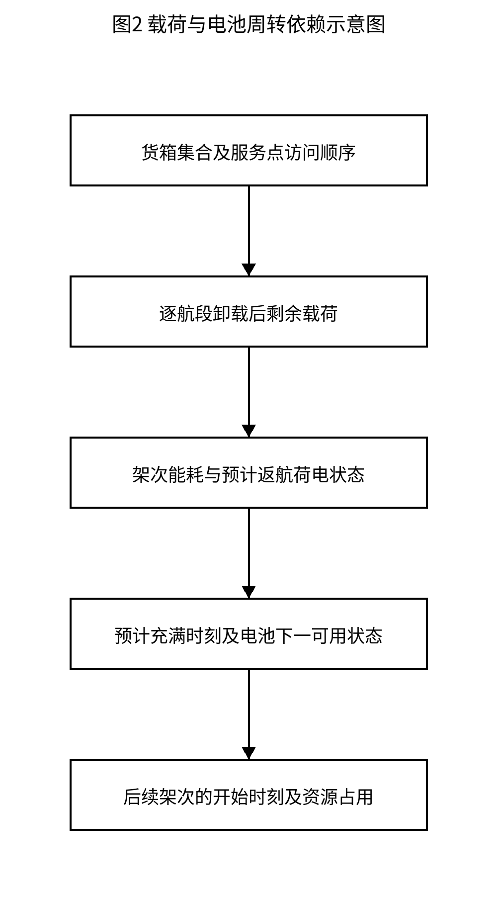
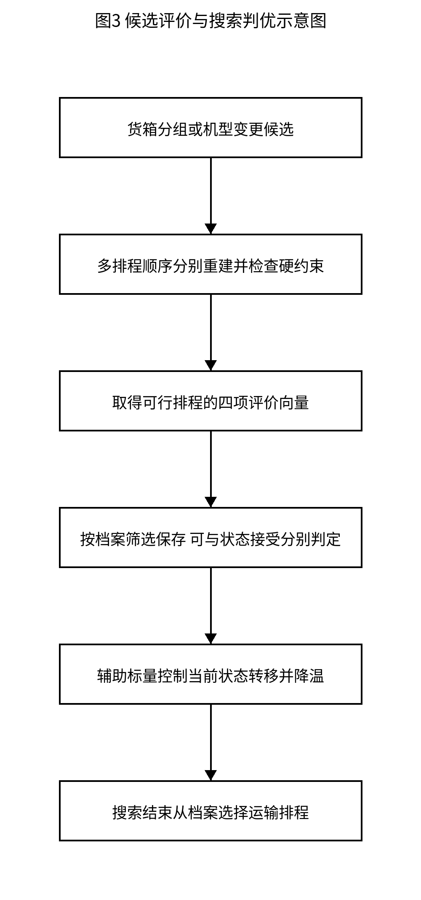

# 一种异构无人机多点运输与共享电池协同调度方法

## 权利要求书

### 权利要求1

一种异构无人机多点运输与共享电池协同调度方法，其特征在于，由计算机执行以下步骤：
S1，获取配送货箱的编号、目的服务点、质量、体积、期望交付时刻和硬截止时刻，获取航段数据、各机型的承载能力及航时和能耗参数，以及实体无人机与同型共享电池的库存及可用状态；
S2，将配送货箱分配至运输架次并指定候选机型，形成候选架次集合，通过改变货箱所属架次或架次机型生成待评价的候选架次集合；
S3，对所述待评价的候选架次集合中的运输架次，枚举服务点访问顺序，按照完成交付后剩余货箱的质量计算各航段载荷，重新计算航时、架次能耗及预计返航荷电状态，剔除不满足承载能力或返航电量要求的组合；
S4，对所述待评价的候选架次集合，按照多种架次排程顺序分别从相同的资源初始可用状态建立资源时间轴，选择同型的实体无人机和共享电池确定架次开始时刻及逐箱交接完成时刻；依据所述架次能耗计算预计返航荷电状态和返航后充至满电的充电结束时刻，以所述充电结束时刻更新共享电池可用时刻并约束该电池的后续架次开始时刻，同时分别更新实体无人机和共享电池的占用区间；
S5，筛除违反货箱唯一交付、硬截止、库存或资源占用约束的排程，对剩余排程按加权迟到量、运输完成时刻、运输总能耗和架次数的优先次序比较，确定各候选架次集合的评价结果，并据此在有限搜索过程中更新候选架次集合、维护可行方案档案；
S6，从所述可行方案档案中选择方案，依据所选择方案的货箱分配、访问顺序及实体无人机和共享电池绑定记录，独立复算交付时刻、返航电量及资源占用区间，输出经复算满足约束且包含逐箱交付时刻、实体无人机及共享电池绑定关系的运输排程。

### 权利要求2

根据权利要求1所述的方法，其特征在于，所述航段数据根据调度中心、服务点坐标及数字高程模型生成；沿航段采样有效地形高程，以最高采样地形高程与巡航净空高度之和确定巡航海拔，结合节点作业高度计算爬升、巡航和下降航时；分别检查巡航净空以及起降和交接阶段的轨迹与地形相交情况，对数字高程模型越界、无数据或地形相交的航段不作为可行航段使用。

### 权利要求3

根据权利要求1所述的方法，其特征在于，所述运输架次的起飞载荷和总体积分别由其承运的全部配送货箱质量之和与体积之和确定；每完成一个服务点交付，扣除该服务点所交付货箱的质量，以所得剩余载荷计算下一航段能耗；航段能耗包括根据对应机型载荷相关等效航程计算的水平巡航能耗以及爬升附加能耗，全部交付后的返航航段按空载计算。

### 权利要求4

根据权利要求1所述的方法，其特征在于，所述多种架次排程顺序包括期望交付时刻优先、硬截止时刻优先和远距航段优先；每种架次排程顺序均重新分配实体无人机和共享电池、递推架次开始和返航时刻及电池充电结束时刻，使用独立的临时资源状态，取得完整排程后比较所述加权迟到量、运输完成时刻、运输总能耗和架次数。

### 权利要求5

根据权利要求1所述的方法，其特征在于，将实际交接完成时刻超过期望交付时刻的差值与对应货箱的非负优先权重相乘后求和，得到所述加权迟到量；将全部实体无人机完成其最后一个运输架次并返回调度中心的最晚时刻作为所述运输完成时刻；对满足全部硬约束的方案依次比较所述加权迟到量、运输完成时刻、运输总能耗和架次数，当前指标相同时再比较下一指标。

### 权利要求6

根据权利要求1所述的方法，其特征在于，共享电池在再次用于运输架次之前充至满电，其返航荷电状态根据起飞荷电状态与架次能耗相对于电池可用能量的比例确定；充电时长按荷电状态分阶段计算，0%至90%阶段占等效完全充电时长的65%，90%至100%阶段占35%，各阶段按尚需补充的荷电状态增量线性折算；同一电池的任务占用、充电和下一次任务占用区间采用半开区间表示且互不重叠。

### 权利要求7

根据权利要求1所述的方法，其特征在于，生成候选架次集合包括逐对合并运输架次，将两架次的货箱集合合并后重新计算访问顺序、逐航段能耗及整个架次集合的资源排程；对于满足全部硬约束的合并候选，以合并候选的加权迟到量不超过合并前方案加权迟到量的1.02倍作为合并筛选条件，再按加权迟到量、运输完成时刻和运输总能耗比较并选择合并候选。

### 权利要求8

根据权利要求1所述的方法，其特征在于，更新候选架次集合采用合并架次、拆分架次、跨架次移动货箱、跨架次交换货箱以及整架次变更机型的邻域操作；变更机型后重新检查该机型的承载能力、能耗和对应无人机及电池库存；候选架次集合受配置的架次数上限约束，超过上限的候选不作为可行方案进入所述可行方案档案。

### 权利要求9

根据权利要求1所述的方法，其特征在于，所述有限搜索采用模拟退火，根据加权迟到量、运输完成时刻和运输总能耗构成的辅助标量计算候选状态转移的接受概率，并按照降温参数更新温度；用于状态转移的辅助标量与用于最终方案选择的指标优先次序分别处理，对已经评价且符合档案筛选条件的候选更新所述可行方案档案，不以该候选是否被接受为当前搜索状态作为唯一存储条件；采用有限搜索预算或无有效候选的停止条件结束搜索。

### 权利要求10

根据权利要求1所述的方法，其特征在于，所述独立复算以任务属性、航段数据和设备参数为计算输入，从最终输出记录重新确定各货箱的交接完成时刻、各架次逐航段载荷和能耗、返航荷电状态及共享电池充电完成时刻，并检查整箱唯一交付、载重与容积、地形可行性、硬截止、实体无人机及共享电池库存、同一资源区间不重叠以及电池充电完成时刻不晚于其下一次任务开始时刻，使用复算所得数值判定所选择方案是否满足约束。

## 说明书

### 技术领域

本发明涉及无人机物资运输调度和电池资源管理技术领域，具体涉及一种异构无人机多点运输与共享电池协同调度方法。

### 背景技术

多服务点物资运输需要根据不同无人机的载质量、容积和能源能力形成任务架次，并安排具体无人机与电池的重复使用。货箱目的点、优先级及交付时限不同，使同一机队需要在多点访问和多架次执行之间分配有限资源。

若只依据载质量和航线距离形成货箱组合，逐次卸载造成的航段能耗变化及返航电池补电时间不能完整反映在后续出勤安排中。局部移动货箱或改变机型可能改变共享电池的使用顺序，使原有起飞时刻或交付时刻不再满足物理和资源条件。

需要使候选任务变更后的航时、电量、实体资源占用与后续交付时刻采用一致计算，并区分不可违约的硬截止与允许评价偏差的期望交付时刻。

### 发明内容

本发明要解决的技术问题是，在异构无人机多点运输及共享电池重复使用条件下，任务组合变化与后续设备能源可用时刻之间的依赖未被完整更新，导致输出运输排程存在交付超时、返航电量不足或实体资源占用冲突。

为解决上述问题，采用如图1所示由计算机执行的以下步骤。

S1，获取配送货箱的编号、目的服务点、质量、体积、期望交付时刻和硬截止时刻，获取航段数据、各机型的承载能力及航时和能耗参数，以及实体无人机与同型共享电池的库存及可用状态；

S2，将配送货箱分配至运输架次并指定候选机型，形成候选架次集合，通过改变货箱所属架次或架次机型生成待评价的候选架次集合；

S3，对所述待评价的候选架次集合中的运输架次，枚举服务点访问顺序，按照完成交付后剩余货箱的质量计算各航段载荷，重新计算航时、架次能耗及预计返航荷电状态，剔除不满足承载能力或返航电量要求的组合；

S4，对所述待评价的候选架次集合，按照多种架次排程顺序分别从相同的资源初始可用状态建立资源时间轴，选择同型的实体无人机和共享电池确定架次开始时刻及逐箱交接完成时刻；依据所述架次能耗计算预计返航荷电状态和返航后充至满电的充电结束时刻，以所述充电结束时刻更新共享电池可用时刻并约束该电池的后续架次开始时刻，同时分别更新实体无人机和共享电池的占用区间；

S5，筛除违反货箱唯一交付、硬截止、库存或资源占用约束的排程，对剩余排程按加权迟到量、运输完成时刻、运输总能耗和架次数的优先次序比较，确定各候选架次集合的评价结果，并据此在有限搜索过程中更新候选架次集合、维护可行方案档案；

S6，从所述可行方案档案中选择方案，依据所选择方案的货箱分配、访问顺序及实体无人机和共享电池绑定记录，独立复算交付时刻、返航电量及资源占用区间，输出经复算满足约束且包含逐箱交付时刻、实体无人机及共享电池绑定关系的运输排程。

优选地，航段按数字高程模型与飞行阶段构造，按访问顺序逐段扣除已交付货物的质量，并对每一候选分别尝试期望时刻、硬截止及远距航段优先的排程顺序。

优选地，采用两阶段满电充电关系计算共享电池再次可用时刻，采用合并及邻域操作搜索，辅助标量只控制搜索状态转移，最终方案仍按四指标优先次序选择。

### 有益效果

通过逐次卸载后重新计算航段能耗，将货箱分配与访问次序对预计返航电量和充电时长的影响传递到共享电池再次出勤约束，减少沿用过期资源时间轴形成的可执行性错误。

通过对同一候选分别重建多种排程顺序的实体资源时间轴，使候选评价包含不同机体和电池重复使用次序的影响；先筛除硬约束违约，再评价迟到、完成时刻、能耗与架次数。

通过将辅助搜索代价与最终方案排序分开，并从最终记录独立复算物理和资源约束，使搜索状态的接受标签和求解器的可行标签不直接替代最终排程判断。具体指标变化取决于输入实例、模型和有限搜索结果。

### 附图说明

图1为与权利要求1步骤S1至S6对应的协同调度方法流程图，同时作为摘要附图。

图2为逐段载荷、预计返航电量、充电结束时刻及后续架次开始时刻的依赖示意图。

图3为候选排程评价、可行方案档案及模拟退火状态转移分别处理的示意图。

### 公式及符号说明

$$
H_{ij}=\max_{x\in\Gamma_{ij}}z_{\mathrm{DEM}}(x)+\Delta h	ag{1}
$$

式（1）中，i、j为起止节点，Γ_ij为航段沿线有效采样点集合，z_DEM(x)为采样点地面海拔，Δh为巡航净空高度，H_ij为巡航海拔，单位均为m。本实施例取Δh为50 m；起降及交接阶段按各自作业高度单独检查，不将服务点作业高度等同于巡航净空。

$$
t_{gij}=\frac{h_{ij}^{+}}{v_g^{\uparrow}}+\frac{d_{ij}}{v_g^{c}}+\frac{h_{ij}^{-}}{v_g^{\downarrow}}	ag{2}
$$

式（2）中，g为机型，d_ij为水平距离，h_ij的上升项等于max(0,H_ij−z_i^work)，下降项等于max(0,H_ij−z_j^work)；z_i^work、z_j^work为节点作业海拔。三种速度分别为爬升、巡航和下降速度，单位m/s且为正，航时t_gij以s计。节点作业高度、巡航海拔和高程使用同一基准。

$$
q_{p0}=\sum_{k\in K_p}m_k,\quad q_{pr}=q_{p,r-1}-\sum_{k\in K_p:s(k)=i_r}m_k	ag{3}
$$

式（3）中，K_p是架次p承运的全部货箱集合，m_k为货箱k质量kg，s(k)为其目的服务点，i_r为第r个访问点。q_p0为起飞载荷，q_pr为第r个访问点交付完成后剩余载荷；下一航段采用q_pr，最后返航段为零。这里以逐次扣减形式表述来源的剩余载荷求和关系。

$$
\sum_{k\in K_p}m_k\le Q_{g_p},\qquad\sum_{k\in K_p}v_k\le V_{g_p}	ag{4}
$$

式（4）中，Q_gp、V_gp分别为机型g_p载质量kg和容积m³，v_k为货箱体积m³，K_p覆盖全部目的服务点的承运货箱。对一个多点架次按总货物质量和总体积检查，而不是分别对各服务点通过检查后就认定总载荷可行。

$$
L_g(q)=L_g^0-(L_g^0-L_g^F)\left(\frac{q}{Q_g}\right)^{3/2}	ag{5}
$$

式（5）中，L_g(q)为载荷q下水平等效航程m，L_g^0和L_g^F为空载和满载航程，Q_g为最大载质量kg，0≤q≤Q_g，且L_g^0≥L_g^F>0。该式保留来源所用载荷拟合模型，指数3/2属于此计算实施方式的模型参数。

$$
E_{gij}(q)=\frac{d_{ij}E_g^{\mathrm{use}}}{L_g(q)}+\frac{(m_g^0+q)g_0h_{ij}^{+}}{3.6\times10^6\eta_g^{\uparrow}}	ag{6}
$$

式（6）中，E_g^use为机型g单组电池可用能量kWh，m_g^0为含电池空载质量kg，g_0为重力加速度m/s²，η_g上升项为无量纲爬升效率，3.6×10⁶为J至kWh换算因子，所得E_gij以kWh计。等效航程按对应电池配置的水平能耗口径解释，爬升另计，下降附加项在本实施例取零。本例使用来源的建模展开，改变能耗标定需重新评价全部候选，不能直接沿用原能耗或原排序。

$$
E_p=\sum_{(i,j)\in\mathcal R_p}E_{g_pij}(q_{p,ij})\le(1-\rho_{g_p})E_{g_p}^{\mathrm{use}}	ag{7}
$$

式（7）中，R_p为从调度中心出发、完成多点交付并返回的全部航段，q_p,ij为对应航段载荷，E_p为架次能耗kWh，ρ_gp为返航储备比例，取值在0与1之间。本例运输任务能耗按式（6）累计。

$$
\sigma_{pb}^{\mathrm{ret}}=\sigma_{pb}^{\mathrm{start}}-\frac{E_p}{E_b^{\mathrm{use}}},\qquad\sigma_{pb}^{\mathrm{ret}}\ge\rho_{g_p}	ag{8}
$$

式（8）中，σ_pb^start、σ_pb^ret为电池b执行架次p前后荷电状态，E_b^use为该电池可用能量，兼容关系要求其对应机型配置。本实施例各次出勤前σ_pb^start=1。荷电状态无量纲，充电后的再次使用按式（9）计算，不直接将返航电池认定为满电可用。

$$
t_b^{\mathrm{chg}}(\sigma)=T_b^{\mathrm{full}}\begin{cases}0.65\frac{0.90-\sigma}{0.90}+0.35,&0\le\sigma<0.90,\\0.35\frac{1-\sigma}{0.10},&0.90\le\sigma\le1.\end{cases}	ag{9}
$$

式（9）中，T_b^full为电池等效完全充电时长s，σ为返航SOC，t_b^chg为所需充电时长s。0至90%阶段占65%，90至100%阶段占35%，两个分支在0.90处连续，SOC为1时补电时长为零。系数来自本实施例输入的充电模型，满电出勤条件保留；本例不同电池可并行充电，不加入充电工位排队。

$$
s_p=\max(A_{u_p},A_{b_p})	ag{10}
$$

式（10）中，A_up为实体无人机下一可用时刻，A_bp为共享电池满电下一可用时刻，s_p为架次开始时刻，单位均为s。该实现分配可开始任务的实体机、电池组合，机型须相容。本例货箱已在调度开始时备妥；不额外加入来源未披露的备货释放时刻、运输机准备时长或机体周转时长。

$$
C_{pb}^{\mathrm{end}}=f_p+t_b^{\mathrm{chg}}(\sigma_{pb}^{\mathrm{ret}}),\quad A_{u_p}\leftarrow f_p,\quad A_{b_p}\leftarrow C_{pb}^{\mathrm{end}}	ag{11}
$$

式（11）中，f_p为返航时刻，C_pb^end为充至满电的结束时刻，单位s。更新符号表示在当前临时排程中写入资源状态；机体返航后可用，电池仍占用至补电完成。仅更新该临时副本，其他排程顺序仍以同一初始资源状态计算。

$$
a_k=s_p+\sum_{\ell=0}^{r-1}t_{g_p,i_\ell i_{\ell+1}}+\sum_{\ell=1}^{r}\tau_{i_\ell},\quad s(k)=i_r	ag{12}
$$

式（12）中，i_0为调度中心，i_1至i_n为访问点序列，货箱k交付于第r个点，τ_i为对应点交接时长s；同一架次同一服务点的货箱在该次交接结束时记为交付。a_k是交接完成时刻，包含目的点自身交接时长。本式按来源文字中的交接结束事件作递推展开，与只计算到达目的点时刻相区别。

$$
f_p=s_p+\sum_{\ell=0}^{n}t_{g_p,i_\ell i_{\ell+1}}+\sum_{\ell=1}^{n}\tau_{i_\ell},\quad i_{n+1}=i_0	ag{13}
$$

式（13）中，n为所访问服务点数，i_n+1为返回调度中心，所有交接均计入任务持续时间。f_p用于更新机体和电池时间轴，也用于计算运输完成时刻，不将最后充满全部电池的时刻替代运输完成时刻。

$$
W(X)=\sum_{k\in K}\omega_k\max(0,a_k-\theta_k),\qquad a_k\le D_k\;(k\in K_{\mathrm{hard}})	ag{14}
$$

式（14）中，K为全部货箱，θ_k为期望交付时刻，D_k为硬截止，K_hard为具有硬时限的货箱集合，ω_k为非负优先权重，a_k为交接完成时刻。W为加权迟到量，权重无量纲时单位为s。硬截止违约直接使方案不可行，不通过增加权重将其改成可抵消的软惩罚；无硬截止的货箱不受对应硬不等式约束。

$$
J(X)=\left(W(X),M(X),E(X),N(X)\right)	ag{15}
$$

式（15）中，M(X)=max_p f_p为全部运输无人机最后返回的最晚时刻s，E(X)=各架次E_p之和，单位kWh，N(X)为运输架次数。J为评价向量，按W、M、E、N依次最小化比较；这些不同量纲分量逐项比较，不直接相加。

$$
I_{up}=[s_p,f_p),\quad I_{bp}=[s_p,C_{pb}^{\mathrm{end}})	ag{16}
$$

式（16）中，I_up是机体任务占用区间，I_bp是电池从开始任务直至充满的合并占用区间。同一机体两区间不得相交，同一电池两区间也不得相交，任务、补电和下一次任务使用半开区间，前一区间结束时允许后一区间开始。电池合并区间是任务与紧接补电区间的等价表达。

$$
F(X)=W(X)+\lambda_M M(X)+\lambda_E E(X)	ag{17}
$$

式（17）中，λ_M、λ_E为辅助权重，不改变式（15）的最终优先次序。来源的一组搜索设置采用λ_M=50、λ_E=10⁴。以时间s和能量kWh表示时，λ_M为无量纲，λ_E的换算量纲为s/kWh，F和温度均使用相容单位；改变计量单位须相应换算权重。

$$
P_{\mathrm{acc}}=\min\left(1,\exp\left(-\frac{F(X^{\prime})-F(X)}{T}\right)\right),\quad T_{j+1}=\gamma T_j	ag{18}
$$

式（18）中，X为当前搜索状态，X′为已通过候选评价的状态，T为正温度，γ为0与1之间的降温系数，j为搜索步数。F不增加时接纳，增加时按上述概率接纳；温度取正下界以避免除零。候选是否进入可行方案档案与是否成为当前搜索状态分别判断，档案按式（15）比较。

### 说明书附图

### 具体实施方式

#### 实施例一：物理复算与多顺序资源排程

本实施方式由调度计算机处理多服务点无人机物资运输任务。调度中心是每个运输架次的出发及返回节点，货箱为不可拆配送单元，一个架次可依次交付多个服务点。实体无人机与共享电池分别以唯一编号记录，同型电池可在同型不同无人机之间复用，不能同时承担两个架次。不同机型不可混用的兼容规则按本实施例设备配置给出。图1各步骤与权利要求1的S1至S6一致。

S1：建立同一时空和计量基准。货箱记录编号、目的服务点、质量、体积、期望交付时刻、硬截止及优先权重，设备记录机型、唯一编号、承载能力、速度、航程、电池可用能量、返航余量和充电参数。明确硬时限集合，期望时刻只用于迟到评价。获取库存中实体无人机与共享电池状态并保存为本次排程的共同初始状态，各排程顺序使用独立副本。本例货箱开始调度时已备妥，机体和电池初始可用，电池初始满电。

对采用DEM的山区实例，先将经纬度转成与航段距离一致的米制口径，沿节点间的水平直线采样高程，按式（1）取得巡航海拔，并由节点作业海拔构造爬升、巡航和下降。调度中心作业高度取当地地面高程，服务点作业高度取地面高程加30 m，巡航净空示例取50 m。以1 s间隔并加入阶段边界检查轨迹，分别判定巡航净空和其他阶段不与地形相交。30 m栅格/采样及1 s检查是这一实施例设置，不以离散检查宣称任意连续时刻均有解析保障；遇到无数据或越界，不给出该航段已验证可行的判断。

S2：形成初始架次货箱集合和候选机型。按目的服务点及货箱硬时限属性组批，将首批保障物资及医疗物资等硬时限紧迫货箱单独形成直接往返或小规模候选，其余货箱按目的服务点组批。每个货箱整箱且唯一分配，不能为满足载重把同一个不可拆箱分给两个架次。检查各机型质量、体积和能源能力，对能够承运的组合形成可行初始方案；不存在满足约束的初始方案时记录受影响任务，不能把不可行方案作为已完成调度输出。

在已有候选的基础上，通过合并、移动、交换或拆分货箱集合以及改变整架次机型形成其他候选。每个候选同时保存货箱集合和机型；一次改变也会使相关访问排列和资源时间轴失效，统一送入S3至S5重新评价。载质量和容积不足以承运单个不可拆货箱时，不能通过仅改变访问顺序解决该箱承运问题。

S3：枚举每个候选架次的服务点访问顺序。本例限制每架次不超过3个不同服务点，可枚举不超过6种排列；同一架次同一服务点的货箱一起交接。按式（3）更新航段载荷，按式（4）检查起飞总质量和体积，按式（2）、（5）、（6）计算航时及能耗，按式（7）、（8）筛除返航电量不足的组合。相同货箱集合改变访问顺序后也重新计算，不能只比较总里程而忽略卸载次序。

航程模型参数在与所选机型电池配置一致的条件下使用，Q_g、速度、可用能量、有效航程及完全充电时长为正。使用包含爬升耗能的实测航程数据时，应统一能耗标定口径，避免与式（6）的爬升项重复；本例保留给定模型，未采用替代标定。因此数值结果是在该能耗口径下的计算结果。

S4：对整个候选架次集合分别按期望交付时刻优先、硬截止时刻优先和远距航段优先生成排程。每次从共同初始资源状态的独立副本开始，遍历当前顺序的架次，在库存中枚举同型实体无人机和共享电池，利用式（10）得到可开始时刻，并累计各点交接完成和返航时刻。结合访问排列检查硬截止，保留满足物理、时限和资源约束的完整排程。某顺序无法排出完整方案时，不以其局部已完成部分参与完整方案排序。

期望和硬截止的排程优先级依据架次承运货箱的对应时刻生成；远距航段优先级依据航段距离生成。三种顺序分别计算，不将第一种顺序临时占用的电池状态传递给第二种顺序。实施时对并列优先级采用固定规则以便复核，具体规则不作为本稿必要技术特征。

为每个已选择的架次按式（8）、（9）估计返航电量及补电时长，再依式（11）分别更新机体和电池再次可用时刻。机体返航后可以配用其他满电同型电池，而本次使用的电池在充满前不能再次分配。图2示出载荷和能耗到充电再到后续起飞的依赖关系；式（12）以交接结束为交付事件，式（13）计入最后返航航段。

本实施例不同电池可并行充电，充电时间从架次返航起计算，没有设置充电工位数量和排队模型。不得把机体数量代替电池库存，也不得将机体返航即释放的规则套用到尚在充电的电池。共享兼容关系按实体编号检查，一个电池对应一个资源记录。

S5：先检查全部硬约束，再计算式（14）、（15）的评价向量。硬约束包括货箱唯一交付、起飞载质量和容积、可验证地形、返航余量、指定硬截止、实体机和电池库存及区间不重叠；任何一个硬约束未通过的完整排程不作为可行方案。三种排程顺序中按四项优先次序较好的完整排程作为该候选的评价结果。

搜索过程中根据候选评价结果继续改变货箱分组或机型，在有限预算内保存可行候选。采用模拟退火时，式（17）、（18）控制当前状态是否转移，式（15）决定档案中的最终方案次序；两者用途不交换。一个候选可以没有成为当前搜索状态而仍被存入符合筛选条件的档案，不因状态转移拒绝就自动丢弃其可行排程。

S6：按式（15）选取待输出方案，并由独立检查程序以任务、航段及设备参数重新计算。该程序不采用求解器给出的“可行”标签作为检查结果，也不直接相信缓存的能耗或交付时刻，而是从最终货箱集合、访问顺序、机型和具体设备编号恢复逐箱交付与各资源区间。复算结果通过约束检查后输出运输排程，记录架次、货箱、服务点访问顺序、机型、实体无人机、电池、开始/返航、交接完成、预计返航电量及充电结束时刻。

同一机体的任务区间以及同一电池的任务—补电区间分别检查互不重叠；电池再次分配时检查上一充电结束不晚于下一任务开始。以未舍入数值判定约束，以显示精度展示结果。全部候选均未通过检查时不输出已验证可行的运输排程。有限优先顺序和有限搜索失败不能证明所有可能排程均不存在。

#### 实施例二：合并及有限邻域搜索

实施例二给出构造—合并—邻域搜索的一种具体实现，具体控制参数是优选设置。架次数、服务点个数和搜索次数取配置值，不把试验中的固定数量作为权利要求1的输入规模限制。

合并阶段逐对选择架次，合并其货箱集合和访问点，对相容机型及访问排列重新计算S3，并对所有架次调用S4重排。满足全部硬约束后，可按合并候选加权迟到量不超过原方案1.02倍筛选，再按迟到量、完成时刻和能耗选择一项合并；无符合条件的合并时停止。1.02约束的是加权迟到量，不是最晚返航时刻。当前迟到量为零时，该条件只允许迟到量仍为零的合并。这一阶段的筛选规则与最终四指标排序用途不同。

邻域阶段采用五类操作：合并两个架次、拆分一个架次、把一个货箱移动到另一架次、交换两个架次中的货箱、整架次更换机型。移动或交换后保持货箱编号唯一并删除空架次；更换机型后选择其对应实体机与电池库存重新评价，不能沿用原机型电量和资源绑定。服务点访问顺序的排列在评价器内部处理，架次排程顺序也在评价器内部分别重建。

若配置架次数上限，拆分操作产生的候选同样须满足上限；当前方案恰达上限时，单独增加一个架次的拆分不作为可行候选，只有其他操作或当前较少架次状态为其留下空间时才可能保留。架次数上限是搜索规模限制，不能等同于实体无人机或电池占用上限，设备库存仍须独立检查。

模拟退火使用正初始温度和降温系数，改善辅助标量时接纳状态，变差时按式（18）概率接纳。一次早期代码设置取温度比例0.15、降温系数0.995和能量权重10⁴，并用有限评价预算及持续无有效候选的停止条件控制运行；超过架次数上限的已提交评价候选计入预算。后期实现采用固定循环预算、多起点和多组辅助权重，其参数配置与早期实现分开使用。

图3示出当前搜索状态、候选评价和可行方案档案之间的关系。先取得候选物理与资源评价，分别进行档案筛选以及状态转移；最后从档案按词典序选择。改变随机种子、初始方案或预算可能得到不同结果，未保证预算增加时各指标都单调改善。

#### 实施例三：给定任务规模下的计算验证实例

实施例三采用山区物资运输的计算实例。调度中心1个、服务点15个、不可拆货箱80个，其中首批保障箱30个，货箱总质量758 kg、总体积2.011 m³。运输无人机A/B/C型分别4/2/2架，共享电池分别6/4/4组。这里的规模和物资分类用于实例说明，期望时刻、硬截止和各货箱优先权重按该实例任务数据输入。

A型含电池空载质量70 kg、最大载质量25 kg、容积0.060 m³、巡航速度12 m/s、空载/满载航程25000/20000 m、电池可用能量4.5 kWh；B型对应为65 kg、30 kg、0.073 m³、15 m/s、28000/16000 m、4.0 kWh；C型对应为69.9 kg、80 kg、0.250 m³、15 m/s、26000/12000 m、8.0 kWh。返航余量取20%，爬升效率取0.72，完全充电时长分别1800、2400、3000 s。爬升和下降速度使用对应输入字段。

按式（7），A/B/C型最大允许架次能耗分别为3.6、3.2、6.4 kWh。按式（9），若某A型电池返航SOC恰为20%，充至满电需1540 s；SOC为90%时需630 s；SOC为100%时为0 s。这组代算说明，满足返航余量并不意味着可以立即重复出勤，下一任务开始仍受满电可用时刻限制。

该实例包含两条不同的求解流程。早期构造31个硬时限可行往返架次，合并至23架次，合并过程末端加权迟到量230806.07、完成时刻11361.33 s、能耗73.969 kWh。另一条改进流程先构造42个往返架次、合并至23架次，其深度搜索起点迟到量5053.25、完成时刻8858.0 s、能耗74.101 kWh。两条流程的中间值不能串成同一条迭代路径。

在上述改进流程中，经多起点、多组权重和有限预算搜索，一组报告的运输终解为23架次，加权迟到量0、运输完成时刻6929.381 s、运输总能耗66.276 kWh。与同一改进流程的23架次起点相比，完成时刻减少21.77%，能耗减少10.56%。这些是对应输入、能耗标定和搜索设置下的实例结果，不作为任意任务都能零迟到的结论，也不作全局最优性证明。

本方法的该实例评价限于运输调度。通信链路保障、空中中继选择及任务分区不属于本例的计算输出；在真实任务另有这些约束时，应提供相应技术实现和数据后另行考虑，不能把本运输排程的汇总指标解释为已经具备全程通信保障。

## 说明书摘要

本发明涉及无人机运输调度及电池资源管理，提供一种异构无人机多点运输与共享电池协同调度方法。获取货箱、航段及设备状态，形成货箱分组和机型候选，按服务点访问顺序逐段更新载荷并复算航时、能耗和预计返航电量；对同一候选以多种排程顺序分别绑定实体无人机与共享电池，将返航补电完成时刻反馈至后续架次。筛除硬约束违约排程，按迟到量、完成时刻、能耗和架次数比较并维护可行档案，经独立复算后输出带逐箱交付时刻及设备绑定的运输排程，以保持任务调整与能源周转计算一致。

## 摘要附图

图1。
